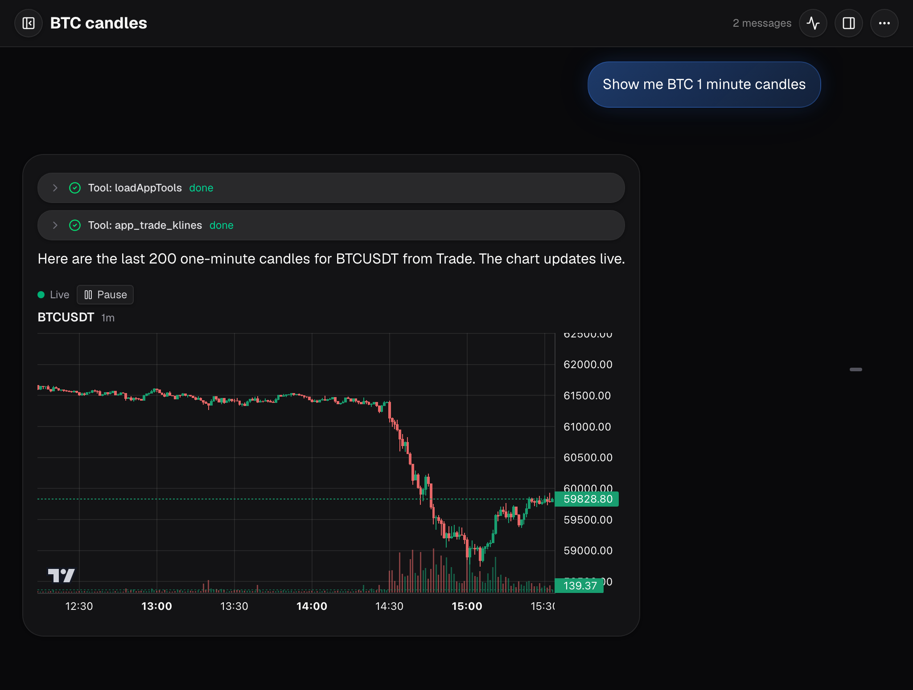
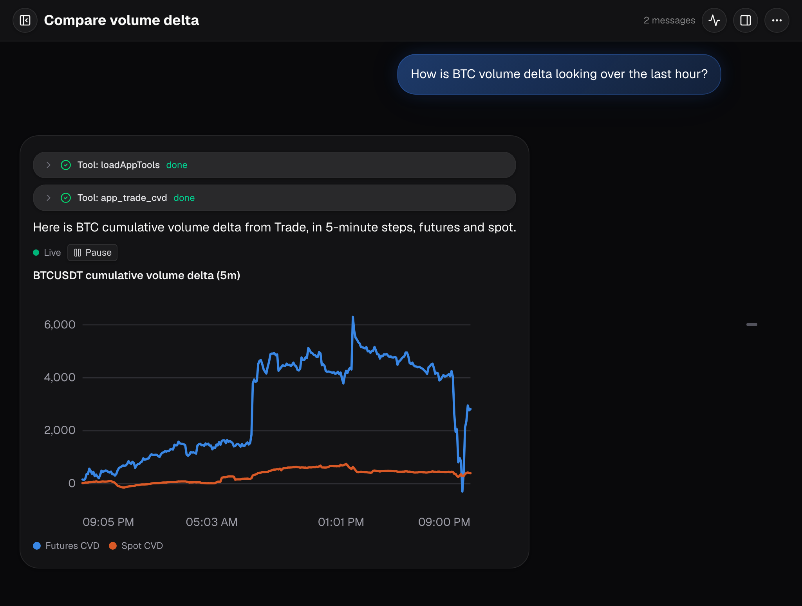
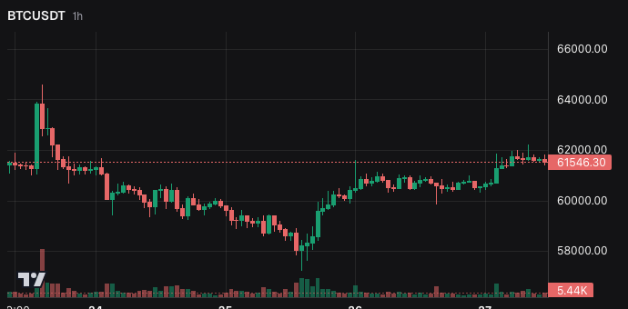
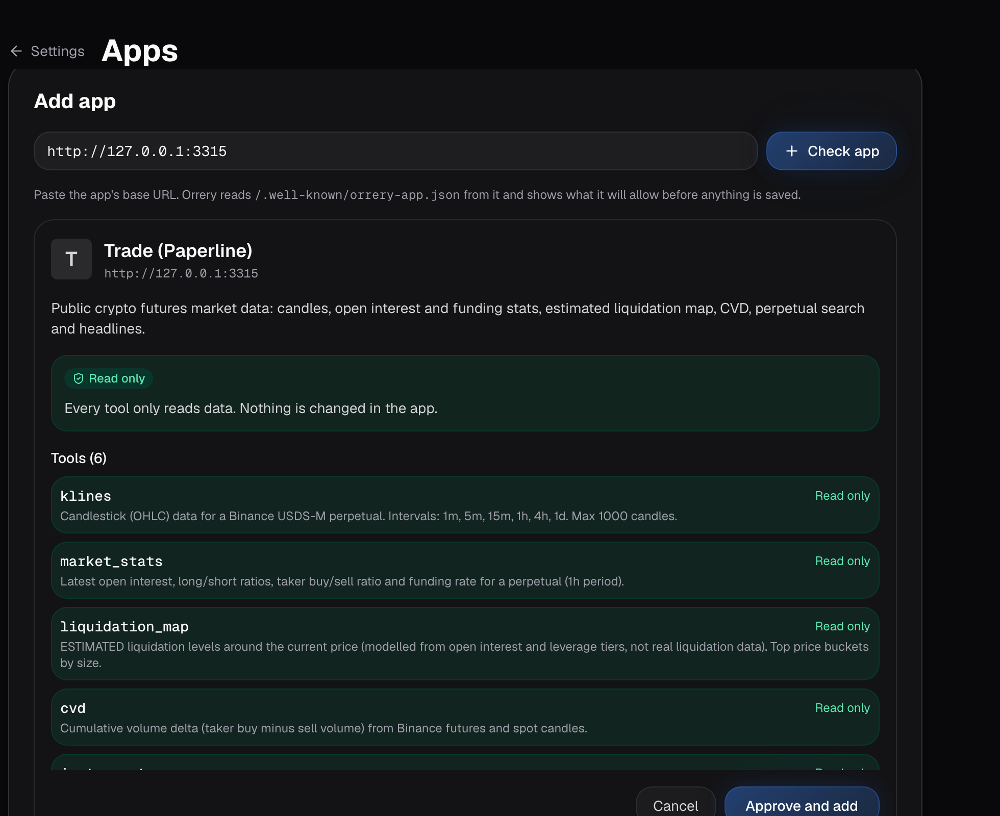

# One chat, four apps

How I made Orrery call my other side projects over MCP, and the bugs I found when I ran them together.

I typed "show BTC 1 minute candles" in Orrery and a candlestick chart came inside the answer. The candles came from Trade MVP, which is a separate app in a separate repo. Orrery only draws them.



## The apps

Orrery is my multi-model chat app, built with Next.js and the AI SDK. The repo is still called DevChat.

I have three more apps:

- StatMesh, a catalog of public statistics that agents can query.
- Print Pro 3D, where you get a 3D model and order a print.
- Trade MVP, which gives crypto market data. For Orrery it exposes public market data only. No portfolio, no orders, no bots.

I wanted one chat that can call any of them, show the result in the answer and give a link to open the app.

## How an app describes itself

Each app serves a small JSON file at `/.well-known/orrery-app.json`. It has the app id, name, one line on what it is good for, the MCP endpoint, the auth type, deep links, the result types it returns, and whether it only reads or can also take actions.

The tools are MCP over plain HTTP. The apps copy a small starter kit with no dependencies: a manifest check, token check, result builders and a minimal MCP handler.

Every call from Orrery carries an HS256 JWT that expires in 60 seconds. The audience is the app id and the subject is the user's email, so the app knows who is calling and counts usage per user.

## Typed results

A tool returns one of six result types: `table`, `timeseries`, `ohlc` for candles, `model3d` for an STL file, `job` for long work with a status tool, and `link`. Orrery picks the renderer by type, never by app. The apps send data and Orrery draws it with its own chart components. No UI code is shared between the repos.

This is what Trade MVP sends for candles:

```json
{"orrery":1,"type":"ohlc","symbol":"BTCUSDT","interval":"1m","candles":[{"t":1700000000000,"o":1,"h":2,"l":0.5,"c":1.5}],"refresh":{"tool":"klines","args":{"symbol":"BTCUSDT","interval":"1m","limit":200},"everyMs":5000}}
```



## Keeping the prompt small

The model does not get every tool of every app on every request. The system prompt has one line per app, around 20 tokens each, and a `loadAppTools` tool. When the model needs an app, it calls `loadAppTools` and gets that app's tools for the rest of the turn.

## Live charts

A result can carry a `refresh` note, like the one in the JSON above. It names one of the app's read-only tools and an interval. While the chart is on screen, Orrery calls that tool again on the server and replaces the data. Polling stops after 15 minutes until you resume it.

I did not want the browser or the model to choose which tool the server calls. So Orrery saves the result with the refresh note and signs it with HMAC. The refresh route reads the note from the saved result and refuses it if the signature does not match.



## Registering an app and opening it

Only the owner can register an app. Orrery reads the manifest and shows a review card with the tools. After approval it pins the app to that origin and shows the secret once.



To open an app from the chat, Orrery sends you there with a single-use sign-in token that lasts 60 seconds. My apps do not share a parent domain, so shared cookies were not an option.

## What went wrong

These bugs only came out when I ran all four apps together on one machine.

- The candlestick chart never loaded app data. Large results were saved in one shape and read back in another.
- An `https://localhost` manifest URL could skip the check that blocks private addresses in production.
- App icons did not show, because Orrery's content security policy blocks outside images. I fixed it by serving icons through an Orrery route and kept the policy strict.

Two problems came from the model. Once the model answered a question about a link without opening it. Another time it drew a chart from numbers it made up. So every prompt now starts with honesty rules. The model must open a linked page before answering, say "I can't check that" instead of guessing, and never invent numbers. A chart with no real data has to say Sample data. The fetch tool is now on by default, so the model can actually open the link.

Then a review found another hole. Page text that the model fetched could steer it into sending private data somewhere. Now fetched text is marked untrusted, and once outside text is in the chat, private tools need your approval before they run.

## Where it stands

The apps integration is shipped in code and tested locally with all four apps. Connecting the apps in production is not done yet, so the hosted chat does not call them today.

Adding a fifth app needs no change in Orrery. It needs a manifest, MCP tools and the typed results.

Orrery: https://dev-chat-beta.vercel.app, code: https://github.com/pathakvikash/DevChat
