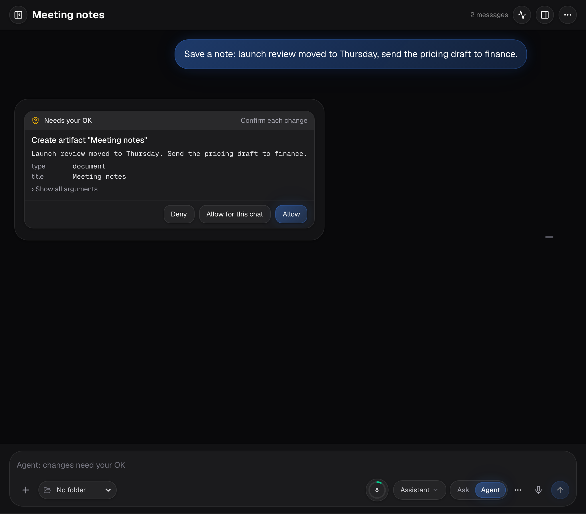
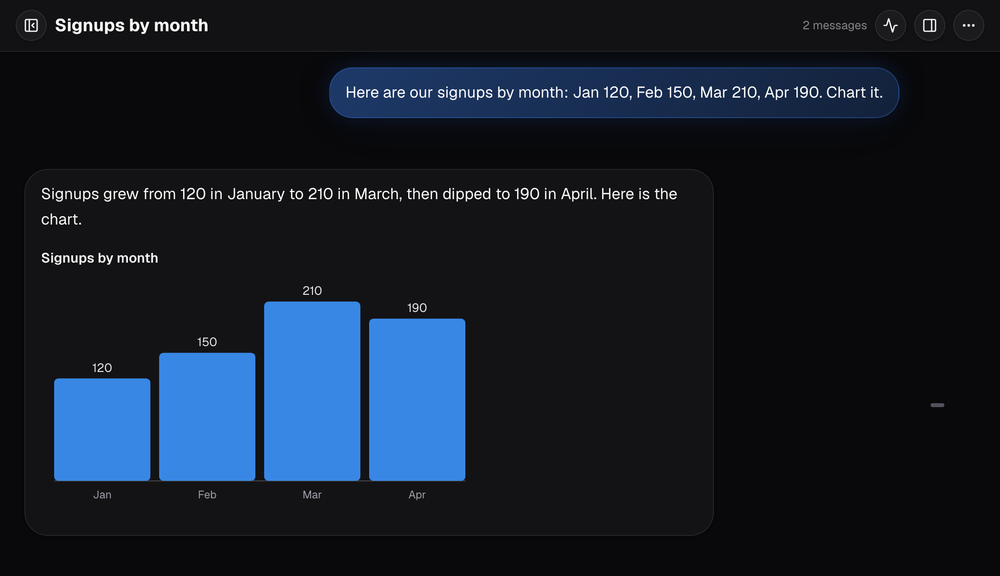
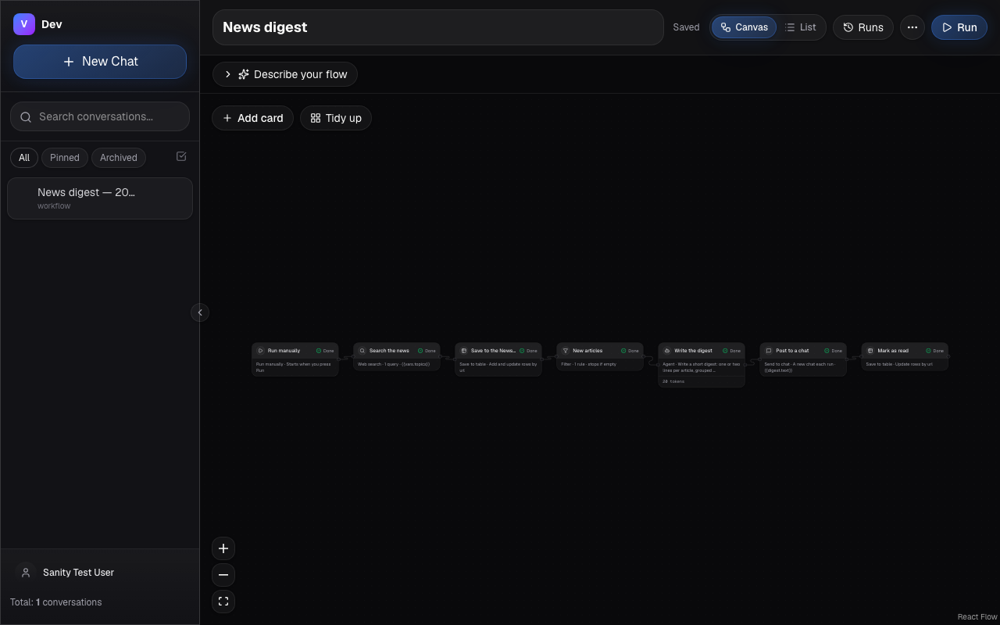

# Orrery: a short how-to

Steps for the things I use most: models, modes, links, charts, workflows and the local bridge.

## 1. Add a model

1. Open Settings and add an API key for Anthropic, OpenAI, Gemini, OpenRouter or NVIDIA NIM.
2. For local models, run Ollama or LM Studio on your computer. With Ollama, `ollama pull <model>` and it shows up in the model picker.
3. Pick the model from the model picker.

On the hosted site, the server cannot reach Ollama or LM Studio on your laptop. The local bridge can (step 6): it lists your Claude Code, Ollama and LM Studio models.

## 2. Pick Ask or Agent

1. Under the message box there is an Ask | Agent switch.
2. Ask is for questions and lookups. It uses read-only tools like web search.
3. Agent can create artifacts, to-dos and memory and use connected tools.
4. Open Mode options next to the switch. Turn on Confirm each change if you want Agent to stop before each change. You get a card with Deny and Allow, and for most tools also Allow for this chat.
5. Turn on Plan first to get a plan you approve before anything changes.

## 3. Ask about a link

1. Paste the full link in your message and ask a specific question.
2. The model opens it with the fetch tool. Each page read shows as a tool card.
3. If the model wants to open a link you did not type yourself, it asks you first.

Only the first 8,000 characters of a page are read. The model is told to say "I can't check that" rather than guess, but still check numbers and quotes against the page.

## 4. Make a chart

1. Paste your data or attach a file.
2. Ask for the chart, for example "bar chart of these monthly totals".

The data has to come from you, a file or a tool. If there is no real data, the model asks for it or labels the chart Sample data.

## 5. Run a workflow

1. Open Workflows from the sidebar.
2. Click New workflow and pick News digest, or start blank and use Describe your flow.
3. Click a card to fill in its settings.
4. Press Run.
5. Open Runs to see past runs, newest first. The last 50 are kept.

A workflow runs only when you press Run. Scheduled runs are not built yet.

## 6. Use Claude Code from the hosted site

1. In your clone of the repo, run `npm install` and then `npm run bridge`. Copy the token it prints.
2. Add a project folder: `npm run bridge -- --add /path/to/project`.
3. In Orrery, open Settings > Local bridge and paste the token.
4. Pick a Claude Code model and the folder in the chat, or an Ollama or LM Studio model marked via local bridge.

The bridge starts in plan mode, which is read-only. `npm run bridge -- --max-mode agent` allows edits. `--max-mode ask` also allows commands, and each command must be confirmed by typing yes in the bridge's terminal. Use Chrome or Firefox; Safari blocks the page from reaching the bridge.

## 7. Connect an app

Apps like StatMesh, Print Pro 3D and Trade MVP connect through Settings > Apps. Only the site owner can register one. The code for this is shipped and tested locally, but the apps are not connected on the hosted site yet.

Orrery: https://dev-chat-beta.vercel.app, code: https://github.com/pathakvikash/DevChat
