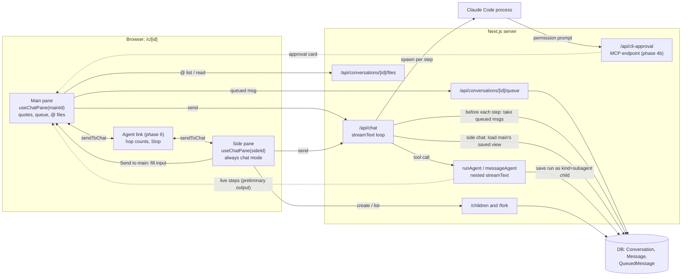

# DevChat: chat upgrades, side chat, modes, sub-agents and agent messaging

Spec and design. Branch `feat/providers-byok-cli`, 2026-10-29. Checked against `ai` 6.0.235, `@ai-sdk/react` 3.0.237, `next` 16.2.6, `@modelcontextprotocol/sdk` 1.29.0 and Claude Code 2.1.296 (section 8).

Implementation starts from section 4: each phase lists the exact files to touch and the vitest cases.

---

## 1. Summary

Thirteen features in six phases, mostly modelled on Claude Code. Small, text-only features come first. The bigger agent features build on them.

- **Phase 1, quick wins**: quote-reply, export to Markdown, `/compress <focus>`, temporary chat, search past chats.
- **Phase 2, input upgrades**: a message queue that reaches the model mid-reply, and `@` to attach files from the working folder.
- **Phase 3**: one chat hook per pane, then a side chat next to the main chat, and "fork from here".
- **Phase 4**: two new modes, Ask (approve each action) and Plan (plan first, then approve).
- **Phase 5**: sub-agents the model can start.
- **Phase 6**: main chat, side chat and sub-agents can message each other.

Every feature works with API/BYOK models, older models and local Ollama models, not only Claude or the CLI providers. Claude Code-only extras sit on top of a generic path.

| Phase | Features | Schema change |
|---|---|---|
| 0 | Compression fix (prerequisite) | none |
| 1 | Quote-reply, export, `/compress <focus>`, temporary chat, search past chats | `Conversation.temporary` |
| 2 | Message queue, `@` files | new `QueuedMessage` table |
| 3 | Per-pane refactor, side chat, fork from here | `Conversation.parentId`, `kind`, `forkedFromId` (one migration) |
| 4 | Ask before acting, plan mode | none |
| 5 | Sub-agent | none |
| 6 | Agent messaging | `QueuedMessage.agent` |
| Later | Background agents (parked) | sketch only, section 6 |

### Compatibility rule

- Text-only features work for every provider: quote-reply, export, compress focus, temporary chat, `@` files, fork, side chat, queue.
- Text pulled in from elsewhere (the side chat's view of the main chat, `@` file contents, `readChat`) is trimmed to the receiving model's context window. Small Ollama windows get less. The user sees what was cut.
- Tool features need `supportsTools` (`ModelConfig`, `src/lib/models.ts:26`). The route already sends no tools at all to a model without it (`useTools`, `route.ts:150`). Those models get a button or slash command instead:

| Feature | Needs | Without tool support |
|---|---|---|
| Search past chats | `searchChats`, `readChat` tools | `/recall <query>` adds the results to your message |
| Queue delivered mid-reply | a multi-step run | one-step replies: queued messages go as the next message |
| Ask mode | approval cards on tool calls | behaves like Chat (the model cannot act anyway) |
| Plan mode | `presentPlan` tool | "Approve plan" button on the last reply |
| Sub-agent | `runAgent` tool | not offered |
| Side chat → main | nothing | "Send to main" button (all models) |
| Agent messaging | `sendToChat` tool | "Send to side chat" / "Send to main chat" buttons start one message; no replies back |

### Decision table

Product decisions (settled):

| # | Decision |
|---|---|
| 1 | Phase order as in the table above. Background agents are parked. |
| 2 | Out of v1: background sub-agents (parent keeps working while a helper runs) and sub-agent to sub-agent messaging. |
| 3 | Every feature works with API/BYOK, older and local Ollama models. Claude Code-only extras sit on top of a generic path, never instead of it. |
| 4 | Tool-less models get graceful fallbacks (buttons, slash commands), not the CLI text tool-call protocol. A per-model toggle could add that protocol later. |
| 5 | Text pulled into a prompt from elsewhere is trimmed to the receiving model's context window, and the user is shown what was cut. |
| 6 | Quote-reply: select text in any message (main or side) and a "Reply" button appears; clicking adds a quote card above that pane's input. |
| 7 | A quote card has the quote (shortened on screen, full text kept), a one-line instruction box and ×. Cards stack; the input stays free. |
| 8 | Keys: Cmd+Enter (Ctrl+Enter) in a card sends only that card; Enter in a card sends everything; the main input keeps Enter = send, Shift+Enter = newline. |
| 9 | Quotes go out as one plain-markdown user message: each quote as a `>` block, then its instruction, then the typed text. |
| 10 | Export: `/export` and the header menu download a Markdown file: text, quotes, tool calls as one-liners, artifacts by title. |
| 11 | `/compress <focus>`: optional focus text passed into the compression prompt. |
| 12 | Temporary chat: a "Temporary" toggle on a new chat; hidden from sidebar and search; memory read and write off; deleted when you leave it for another chat; temporary chats older than 24 h are cleaned up. |
| 13 | Search past chats: read-only `searchChats(query)` (top 5 of your own non-temporary main chats: title, date, snippet, id) and `readChat(id)` (its recent messages, trimmed). Tool-less: `/recall <query>`. |
| 14 | Queue: Enter during a reply makes a chip above the input, editable and removable until delivered. |
| 15 | The browser posts a queued message to the server at once; `/api/chat` picks it up between steps and shows it as a user bubble in the reply. |
| 16 | Whatever is still queued when the reply ends goes as the next normal message. Stop puts undelivered messages back in the input box. |
| 17 | The queue is stored in a small `QueuedMessage` table in both Prisma schemas. |
| 18 | The queue belongs to each pane's chat state, so the side chat gets one and agent messages reuse it. |
| 19 | `@` files: only when the chat has a working folder. `@` opens a picker; picked files show as chips; on send their contents are inlined as fenced blocks with a path header, capped per file and in total to the model's context budget. The file route keeps paths inside the folder and refuses `.env*`, key and credential files. |
| 20 | Side chat: a docked second pane on `/c/[id]`. It sees the main chat and never adds to it. |
| 21 | Live context: every side-chat send loads the main chat's saved messages. A main reply still streaming is not visible until saved. |
| 22 | The side chat sees the main chat's own view: compression summary, messages since compression (with tool calls and results), working folder path, todo list, artifact titles (not contents), in a "Main conversation" system prompt section. |
| 23 | Each side-chat reply has "Send to main", which fills the main chat's input box. Nothing is sent without the user. |
| 24 | Side chats and sub-agent runs are child conversations: kept across reloads, deleted with the main chat, hidden from the sidebar. |
| 25 | Many side chats per main chat. The pane shows the latest, with "New side chat" and a menu of older ones. |
| 26 | The side chat has its own model picker (defaults to the main chat's model) and is always in chat mode. |
| 27 | Layout: dock left or right, drag to resize, side and width remembered in browser storage. |
| 28 | Open with Cmd+\ (Ctrl+\), `/side`, or the command palette. Narrow screens: full width over main. Overlay panels still open on top. |
| 29 | Both panes can stream at once. Shortcuts act on the focused pane. |
| 30 | Side chats get no next-message suggestions and no memory consolidation; their own auto-compress and titles work as normal. |
| 31 | Fork from here: on any message, a new normal chat (in the sidebar) with copies of the messages up to and including it and the same settings. `forkedFromId` with `onDelete: SetNull`, so deleting the original keeps the fork. The header shows "Forked from <title>". Not a child. The existing `branch` endpoint (truncate) stays for regenerate. |
| 32 | Mode switch becomes Chat · Plan · Ask · Agent, per conversation. |
| 33 | Ask: every mutating tool and every MCP tool call shows an Allow / Deny card, with "Allow for this chat" per tool, using the AI SDK's `needsApproval`. Tool-less models: Ask = Chat. |
| 34 | Ask with Claude Code: its own file edits go to the same card through `--permission-prompt-tool`, backed by a DevChat MCP endpoint; the CLI watchdog pauses while waiting. OpenCode and Codex run read-only in Ask mode, and the UI says so. |
| 35 | Plan: read-only tools; the model ends with a plan; a card with Approve (pick Ask or Agent, then it starts) or Revise. Tool models use `presentPlan`; tool-less models get an "Approve plan" button; Claude Code also gets `--permission-mode plan`. `/plan <task>` switches to Plan mode with that task. |
| 36 | Sub-agents start only when the model calls `runAgent` (the user can ask in words). `/agent` comes later. |
| 37 | A sub-agent gets only the parent's brief and the working folder, never the main history. |
| 38 | A sub-agent runs in the parent's mode, without browser-only tools (`executeCode`, `askClarification`), and cannot start sub-agents. |
| 39 | Same model as the parent. CLI models work as parent and as sub-agent; CLI parents run one sub-agent at a time. |
| 40 | Foreground only. API-model parents may run up to 3 sub-agents in parallel in one step. |
| 41 | Limits: 15 steps, 5 minutes, report capped at 8,000 characters, token use on its card. Stop stops sub-agents too. An error or timeout goes back to the parent as an error result; the parent carries on. |
| 42 | A live card in the parent's message shows the sub-agent's steps. "Open" shows its saved transcript in the side pane. |
| 43 | Messaging: main ↔ side chat, and parent → finished sub-agent (the follow-up resumes it from its saved transcript). |
| 44 | A message from another agent is labelled "from main chat" / "from side chat" in the receiver's transcript, so the model knows it is not the user. |
| 45 | The receiver replies on its own, up to 3 messages back and forth per user send, then waits for the user. A "talking" indicator and Stop show meanwhile. |
| 46 | If the receiver is busy, the agent message waits in the receiver's queue (delivered between its steps, or right after its reply). Messaging runs in the browser; the server keeps no background state. |

Design decisions (made in this doc; 3.14 lists where they differ from the brief):

| # | Decision |
|---|---|
| 47 | `Conversation` gets `parentId` + `kind` (child conversations) and `forkedFromId` (forks). The sidebar lists `parentId: null, temporary: false`. |
| 48 | A queued message delivered mid-reply stays inside the assistant message as a `data-queued-message` part (one row per reply). It is split back into its own user message only when history goes to a model. |
| 49 | Agent messages are a `data-agent-message` part `{ from, fromConversationId, hop }` in the user message. No `Message` schema change. |
| 50 | One shared helper, `contextWindowFor`, gives a model's usable window (the logic the Context route already has); all trimming budgets derive from it. |
| 51 | `/api/chat` stays the only chat endpoint. The side chat's section is built inside `buildSystemPrompt`, so the Context panel counts it. |
| 52 | Export reuses the existing (unused) server route `GET /api/conversations/[id]/export`, fixed for v6 tool parts. The header's inline builder is removed. |
| 53 | Approvals use AI SDK v6's `needsApproval` with `experimental_toolApprovalSecret`, so the browser cannot change an approved tool's input. |
| 54 | `runAgent` is built inside `buildTools` and runs a nested `streamText`. Progress travels as preliminary tool outputs, not `data-*` parts. |
| 55 | Loop guards stop throwing or quitting mid-task. They force one text-only step (`toolChoice: "none"`) so a turn always ends with a written answer. |
| 56 | Client: one hook per pane (`useChatPane`) plus one page hook. A hand-written split container, no new dependency. |
| 57 | Messaging uses a browser-run `sendToChat` tool. Replies go back only when the receiver calls `sendToChat` too. Parent → sub-agent uses a server tool, `messageAgent`. |

---

## 2. Spec

Each feature: what the user does, behaviour, edge cases, acceptance criteria, and which models it works with.

### Phase 1: quick wins

#### 2.1 Quote-reply

As a user, I select a sentence in a reply and ask about just that, or pick three parts of a long answer and comment on each.

**Behaviour**

- Selecting text inside one message (user or assistant, main or side pane) shows a small "Reply" button near the selection. The selection must start and end in the same message.
- Clicking adds a quote card above that pane's input and clears the selection.
- A card shows the quote shortened to about 3 lines with "…", keeps the full text, and has a one-line instruction box and ×.
- Cards stack in order. The main input stays free.
- Keys:
  - In a card's instruction box, **Cmd+Enter / Ctrl+Enter** sends only that card. Other cards and typed text stay.
  - In a card's instruction box, **Enter** sends everything: all cards plus the typed text.
  - In the main input: **Enter** sends everything, **Shift+Enter** is a newline. Unchanged.
  - Cmd+Enter elsewhere keeps today's global "send" (`src/app/hooks/useKeyboardShortcuts.ts:40`), which now includes the cards. A card's Cmd+Enter must not also fire it.
- The sent message is plain markdown:

  ```
  > first line of quote one
  > second line of quote one

  instruction one

  > quote two

  instruction two

  typed text
  ```

- In the user's own bubble, `>` lines show as a quote block (user bubbles are plain text today, see 3.11).
- If a reply is running, the composed message is queued (phase 2) as one chip.

**Edge cases**

- Selection across two messages, or outside any message: no button. Inside the input, a card or a dialog: no button.
- Inside a code block: works; the code block header ("python", "Copy", "Run") does not leak into the quote.
- Inside a chart or table: works on the visible text.
- Markdown formatting in the selection (bold, links, bullets) is lost. The quote is the rendered text.
- Empty instruction: the quote is sent with no instruction line.
- Switching conversation drops the cards.

**Acceptance**

- One message selected → "Reply"; two messages → none.
- Two cards plus typed text, Enter → exactly one user message in the format above.
- Cmd+Enter in card 2 → only card 2 is sent, card 1 and the text stay, exactly one request leaves.
- A code-block quote has the code and none of the header labels.

**Works with**: every model (plain text).

#### 2.2 Export to Markdown

As a user, I save a chat as a Markdown file to keep or share.

**What exists today**: the header's "More" menu already has "Export Markdown" and "Export JSON", built in the browser from each message's plain `content` (`ConversationHeader.tsx` ~65-79): no tool calls, and the date is the export time. A server route `GET /api/conversations/[id]/export?format=markdown|json` also exists, nothing calls it, and it only understands old part types (`tool-invocation`, `tool-result`), so v6 tool calls are dropped.

**Behaviour**

- `/export` and the header's "Export Markdown" both download from the server route. The browser builder goes.
- The file: title, model, created date; then every saved message in order (including messages from before a compression, with a line where the summary was made):
  - text as written; quotes stay `>` blocks;
  - tool calls as one-liners: `` [tool] webSearch {"query":"…"} → ok `` (or `→ error`);
  - artifacts by title: `[artifact] "Sales by month" (data)`;
  - generative UI as `[chart]` / `[table]`;
  - queued messages (phase 2) as a user line "sent while replying"; agent messages (phase 6) with their "from …" label;
  - sub-agent cards (phase 5) as `[sub-agent] title: done, 3,120 tokens`.
- JSON export unchanged.

**Edge cases**: a temporary chat can be exported; a side chat exports itself only; a reply still streaming is not in the file (saved state only).

**Acceptance**: a chat with a web search, an artifact and a chart exports all three as one-liners; a compressed chat exports every message.

**Works with**: every model.

#### 2.3 `/compress <focus>`

As a user, I compress a long chat but tell the summarizer what matters most.

**Behaviour**: `/compress` works as today. `/compress keep the API decisions and open bugs` passes the text (up to 500 characters) to the compression prompt as "Pay special attention to: …". Auto-compress is unchanged (no focus).

**Edge cases**: focus longer than 500 characters is cut; an empty focus is the same as plain `/compress`.

**Acceptance**: the compression request includes the focus line; the summary mentions the focused topics.

**Works with**: every model (the summarizer is the chat's own model for manual compress, `compress/route.ts:29`).

#### 2.4 Temporary chat

As a user, I ask something I don't want kept, remembered or shown in my history.

**Behaviour**

- A new chat (no messages yet) shows a "Temporary chat" toggle in its empty state. Turning it on marks the chat temporary and turns memory off.
- The header shows a "Temporary" badge.
- Hidden from the sidebar, from search and from `searchChats`.
- Memory is not read (no memory block in the prompt) and not written (no `rememberFact` / `forgetFact`, no memory consolidation).
- Leaving it for another chat deletes it (with its messages, artifacts, side chats and traces).
- Temporary chats untouched for 24 hours are deleted the next time the sidebar loads.

**Edge cases**

- Closing the tab does not delete at once; the 24-hour cleanup does.
- Fork is hidden in a temporary chat (a fork would keep what the user chose not to keep).
- Side chats of a temporary chat go with it.
- Turning "Temporary" off after the first message is out of scope.

**Acceptance**: a temporary chat never appears in `GET /api/conversations` or search; after navigating to another chat it is gone from the DB; a memory-saving request in agent mode has no memory tool.

**Works with**: every model.

#### 2.5 Search past chats

As a user, I ask "what did we decide about the cache last week?" and the model looks it up in my other chats.

**Behaviour**

- `searchChats({ query })` returns the top 5 of the user's own main, non-temporary chats, not counting the current one: title, date, a snippet around the match, id.
- `readChat({ id })` returns that chat's summary (if compressed) and its most recent messages, trimmed to the current model's budget.
- Both are read-only and available in every mode.
- Tool-less models: `/recall <query>` runs the same search in the browser and sends a message with the results above the user's words (the same pattern as `/search`, `runCommandAction.ts` ~26-39).

**Edge cases**: no results → "No matching chats"; an id from another user, a temporary chat or a child → "not found"; a huge chat → trimmed with a "showing the last N of M messages" line.

**Acceptance**: asking about a topic from another chat makes the model call `searchChats` then `readChat` and answer from it; `/recall cache` on a tool-less Ollama model sends the results.

**Works with**: tool models via the tools; every model via `/recall`.

### Phase 2: input upgrades

#### 2.6 Message queue

As a user, I see the model going the wrong way and type a correction without waiting.

**Behaviour**

- While a reply runs, Enter (in the input or a quote card) makes a chip above the input. The hint changes from "Type ahead · Enter sends when the reply finishes" (not true today: Enter does nothing while loading, `chatInput.tsx` ~379-385, hint ~515) to "Enter queues · the model sees it at its next step".
- The browser sends the chip to the server at once. It stays editable and removable until the server takes it.
- `/api/chat` checks the queue before each new step of the running reply. A waiting message is added to the model's history as a user message and shows in the reply as a small user bubble at that point. Its chip disappears.
- If the reply has no further step (the model is already writing its final text), the message goes as the next normal message when the reply ends. Several leftovers are joined with a blank line.
- Stop: undelivered chips go back into the input box. Delivered ones stay in the stopped reply.

**Edge cases**

- Edit or remove a chip just as the server takes it: the server wins. The edit fails with "already delivered" and the chip turns read-only until it shows in the reply.
- Stop with some delivered, some not: delivered ones are saved inside the stopped reply; the rest go back into the input box.
- Reload with undelivered chips: reload stops the reply, so the Stop rule applies on the next load.
- A queued message while a sub-agent runs (phase 5): delivered to the parent at its next step, after the sub-agent step; the sub-agent never sees it.
- Queue plus quote cards: cards are composed into the text when it is queued.
- The reply pauses for a browser tool (`executeCode`) or an approval card (phase 4): the queue waits until the turn is really over.
- Regenerate a reply that contains delivered queued messages: their text goes back into the input box first.
- The 5-step cap is reached: leftovers go as the next message.

**Acceptance**

- During a reply with a tool step, a queued message appears as a bubble between steps and the next step answers it.
- Reloaded, the bubble is in the same place, and the next turn sends the model user → assistant → user → assistant in order.
- Editing a delivered chip fails and the chip shows "delivered".
- Stop with one undelivered chip puts its text in the input box and leaves no `QueuedMessage` row.

**Works with**: every model. Mid-reply delivery needs a multi-step run, so it happens for tool models (API, Ollama with tools, CLI). A model without tools answers in one step; its queued messages go as the next message. CLI models: between steps only, since each step is a new process.

#### 2.7 `@` files

As a user with a working folder, I type `@chat/route` and attach that file without copying it in.

**Behaviour**

- Only when the chat has a working folder. Typing `@` at the start of a word opens a picker over the folder's files (`git ls-files` in a git repo; otherwise a walk capped at 5,000 files that skips `node_modules`, `.git` and dot-folders). Typing filters; arrows and Enter pick.
- Picked files show as chips above the input; × removes one.
- On send, each file is fetched and added after the typed text as:

  ````
  File: src/app/api/chat/route.ts
  ```ts
  …contents…
  ```
  (cut: first 180 of 694 lines)
  ````

  The fence is longer than any backtick run inside the file, so a file with code fences cannot break out.
- Budget: 35% of the model's context window in total, split evenly across the files, cut at a line boundary. The "(cut: …)" line shows what was left out, in the sent message.
- The file route refuses paths outside the folder (after resolving symlinks), `.env` and `.env.*`, `*.pem`, `*.key`, `*.p12`, `*.pfx`, `*.keystore`, `id_rsa*`, `id_ed25519*`, `.npmrc`, `.netrc`, names containing `credential` or `secret`, and binary files.
- Side chat (phase 3): uses the main chat's folder.

**Edge cases**: a file deleted after picking → the send shows "could not read <path>" in place of its block; a refused file never appears in the picker; a huge file on a small Ollama window → mostly cut, with the note; no working folder → `@` is plain text.

**Acceptance**: `@` lists folder files only; `../`, absolute paths and a symlink pointing outside are refused (403); `.env.local` is neither listed nor readable; a 5,000-line file on a 4k-token model arrives cut with the note.

**Works with**: every model (contents are plain text in the message). CLI models could read the folder themselves; inlining still works the same.

### Phase 3: side chat and fork

#### 2.8 Side chat

As a user, I ask a side question about the main chat without cluttering it, try another model on the same context, and copy a good answer back.

**Behaviour**

- Open with Cmd+\ / Ctrl+\, `/side [question]` (opens the pane and sends the question there), or the palette entry "Toggle side chat".
- The pane shows the latest side chat for this main chat, creating one if none exists. "New side chat" starts a fresh one (or reuses the latest if it is still empty). A menu lists older side chats by title, or by first message if untitled.
- Every send re-reads the main chat from the DB and puts a "Main conversation" section in the side chat's system prompt.
- The section fits the side chat's model: the summary, folder, todos and artifact titles always; then as many of the newest messages as fit. The pane shows "Main chat: last 12 of 40 messages fit" when something was cut.
- Always chat mode. Own model picker (defaults to main's model). Uses the main chat's working folder and knowledge base, read live.
- "Send to main" on each side reply puts its text in the main input (after a blank line if not empty) and focuses it.
- Both panes stream at once. Cmd+Enter sends from the focused pane.
- Dock left/right, drag to resize; side and width remembered; open state is not.
- Narrow screens: the pane covers the main chat, with a close button. Overlay panels open on top of both.
- No suggestions and no memory consolidation in side chats. Auto-compress works. Titles work as they do today: on request (`/title`, sidebar menu). There is no automatic title generation in the app today.

**Edge cases**

- Main chat deleted while the side pane is open (another tab): the side chat is deleted too; its next send gets "Conversation not found".
- Main chat mid-stream: the side chat sees the latest user message (saved when the request starts) but not the reply in progress; the section says a reply may still be running.
- Main chat recently compressed: the side chat sees summary plus newer messages (needs phase 0).
- CLI side chat, no working folder: no folder tools (Claude Code gets `--tools ""`); the section says "Working folder: none". With a folder: read-only CLI tools, even while main writes there.
- `/c/<sideChatId>` opened directly: redirects to `/c/<mainId>?side=<sideChatId>`.
- Reload: both panes reload from the DB; the pane is closed until reopened.

**Acceptance**

- "What did I just ask in the main chat?" is answered right, also after main auto-compresses.
- A side send never adds a row to the main chat.
- A side request with `mode: "agent"` in the body still runs chat-mode tools (`X-Debug-Tool-Mode: chat`).
- Deleting the main chat deletes its side chats.
- `GET /api/conversations` never returns a child.
- "Send to main" fills the box and sends nothing.

**Works with**: every model. On a small Ollama window the section is short and says so.

#### 2.9 Fork from here

As a user, I want to try a different direction from message 12 without losing the original.

**Behaviour**

- "Fork from here" in any main-chat message's action menu.
- Creates a new normal chat, shown in the sidebar, titled "Fork of <title>", with copies of every message up to and including that one (same order, same timestamps) and the same settings (model, persona, system prompt, KB, temperature, max tokens, context length, top-p, chat-only, memory, tool-call cap, reasoning effort, working folder, fallback model).
- Artifacts are copied too, and artifact ids inside the copied messages are rewritten to the copies, so charts keep working if the original is deleted.
- The new chat opens. Its header shows "Forked from <title>" (a link) while the original exists.
- Not copied: todos, side chats, sub-agent runs, queue rows, note, pinned and archived flags.
- The existing `messages/[messageId]/branch` endpoint (truncate, used by regenerate) is unchanged.

**Edge cases**

- Fork point before the main chat's compression: the fork gets no summary (it covers later messages) and all copied messages count.
- Fork point after compression: the summary and `compressedAt` are copied.
- Original deleted: the fork stays (`forkedFromId` becomes null); the "Forked from" line disappears.
- Temporary chats and side panes: no Fork item.
- Forking a message that is still streaming: not offered until it is saved.

**Acceptance**: forking message 3 of 6 gives a chat with exactly messages 1-3 and the same settings; deleting the original leaves the fork and its charts working.

**Works with**: every model.

### Phase 4: Ask and Plan modes

The mode switch becomes **Chat · Plan · Ask · Agent**, per conversation (stored per chat as today, `vas:mode:<id>`).

| Mode | Tools | Changes things? |
|---|---|---|
| Chat | read-only | no |
| Plan | read-only + `presentPlan` | no, ends with a plan |
| Ask | read + write + MCP | yes, each write or MCP call needs Allow |
| Agent | read + write + MCP | yes, without asking (today's Agent) |

#### 2.10 Ask before acting

As a user, I let the model do things but want to OK each change.

**Behaviour**

- In Ask mode the model gets the Agent tool set, but every mutating tool (`mutates: true`: artifacts, todos, memory) and every MCP tool call stops at an Allow / Deny card showing the tool and its input.
- Allow runs it and the reply carries on. Deny tells the model it was denied; it should not retry and should say what it would have done.
- "Allow for this chat" on a card allows that tool for the rest of this chat without asking (stored per chat in the browser).
- Claude Code in Ask mode: its own file edits and commands show on the same card. OpenCode and Codex cannot ask, so in Ask mode they run read-only and the mode switch says "OpenCode can't ask before editing; read-only in Ask mode".
- Sub-agents started in Ask mode run read-only (the AI SDK does not support approvals inside sub-agents).

**Edge cases**

- The user ignores a card and types a new message: the card becomes "Not answered" and counts as denied.
- Several calls in one step: one card each; the reply continues once all are answered.
- Stop while a card is open: the card is dropped; nothing runs.
- Queue: the queue waits until the card is answered.
- Reload with an open card: the card shows again (saved as waiting) and can still be answered.
- A Claude Code card waiting a long time: the CLI watchdog does not kill it.

**Acceptance**: in Ask mode `createArtifact` shows a card, Deny means no artifact row, Allow creates it and the model continues; "Allow for this chat" skips later cards for that tool; a Claude Code edit in Ask mode shows a card and the file is unchanged after Deny.

**Works with**: tool models (API, Ollama with tools, CLI via its text tool protocol). Claude Code adds its own edits on top. Tool-less models: Ask = Chat.

#### 2.11 Plan mode

As a user, I want the model to look around and propose a plan before touching anything.

**Behaviour**

- Plan mode has read-only tools. The prompt says: explore, do not change anything, end with a plan.
- Tool models end by calling `presentPlan({ title, steps, notes? })`. A card shows the numbered steps, a choice of Ask or Agent (default Ask), **Approve** and **Revise** (with a text box).
- Approve switches the chat to the chosen mode and the model starts carrying out the plan in the same reply.
- Revise sends the feedback; the model keeps planning.
- Tool-less models: the last reply in Plan mode gets an "Approve plan" button (with the Ask/Agent choice) that switches mode and sends "Plan approved. Carry it out now."
- Claude Code: read-only tools as in Chat, plus `--permission-mode plan` on top.
- `/plan <task>` switches to Plan mode and sends the task (today it only rewrites the message, `src/lib/commands.ts`).

**Edge cases**: the model answers without calling `presentPlan` → the "Approve plan" button shows instead; the user types instead of using the card → the card counts as Revise with that text; Approve while another pane streams → only this pane changes mode.

**Acceptance**: in Plan mode no mutating tool is offered; Approve with "Agent" makes the next step run with agent tools; `/plan add a cache` lands in Plan mode.

**Works with**: every model (card for tool models, button for the rest).

### Phase 5: sub-agent

#### 2.12 Sub-agent

As a user, I ask "research these three libraries in parallel and compare them", or ask a CLI model to have a helper read the folder and summarise how X works.

**Behaviour**

- The model calls `runAgent({ title, brief })`. The helper gets only the brief plus the working folder, with the parent's model and mode (Plan and Ask parents get read-only helpers).
- A card in the parent's message shows title, status, the helper's steps as they happen (tool and a short label), a preview of its current text, token use, and "Open".
- When done, the helper's final text (cut at 8,000 characters) is the tool result the parent sees.
- API-model parents may call up to 3 at once in one step; a 4th in the same step gets an error result.
- Limits: 15 steps (the 15th is forced to be a written report), 5 minutes.
- Stop stops the parent and every helper; transcripts so far are saved.
- Error or timeout: an error result with partial notes; the parent carries on.
- "Open" shows the saved transcript in the side pane, read-only.

**Edge cases**

- Step cap hit: the report says "stopped at the 15-step limit".
- The parent repeats the same brief twice: the loop guard makes it write its answer instead of erroring (3.5).
- A CLI parent calls three helpers in three steps: the fourth step is forced to be the answer.
- Opening a running helper: shows the brief and "still running".
- Reload while a helper runs: same as Stop.
- A side chat cannot start sub-agents in v1.

**Acceptance**: 3 parallel tasks → 3 live cards and an answer using all 3 reports; a 4th parallel call is refused; a helper that always calls tools ends at 15 steps with a report; a helper past 5 minutes returns an error and the parent still answers; Stop saves a `kind: "subagent"` child with the partial transcript; the next parent turn sends the model only each report, not the step list.

**Works with**: tool models (API, Ollama with tools, CLI). Not offered to tool-less models. A small-window parent still gets at most 8,000 characters per report.

### Phase 6: agent messaging

#### 2.13 Agents messaging

As a user, I tell the side chat "check this with the main chat", or ask the main model to follow up with the helper that researched library B.

**Behaviour**

- Main and side chats get `sendToChat({ text })`, which sends to the other pane.
- The receiver gets a user-role message with a "from main chat" / "from side chat" badge. Its model sees a label saying it came from another assistant.
- The receiver answers on its own. To answer the sender, it calls `sendToChat` back. Plain text stays in its own pane.
- Up to 3 agent messages per user send. A 4th `sendToChat` is refused with "answer the user directly".
- A "talking" indicator and Stop show while agents talk. Stop stops both panes and drops pending agent messages.
- Busy receiver: the message goes into its queue (2.6).
- Side pane closed: it opens (creating a side chat if none).
- Parent → finished sub-agent: `messageAgent({ agentId, message })` resumes the helper from its saved transcript for one more run with the same limits, on a new card.
- Tool-less models: a "Send to side chat" button on main replies (and "Send to main chat" on side replies, next to "Send to main") delivers that reply as an agent message. The receiver answers; nothing goes back.

**Edge cases**: hop cap reached → refusal, indicator clears; the user sends in a pane while agents talk → that pane starts again from hop 0; reload mid-talk → in-flight turns stop, queued agent chips are dropped (the user did not write them), delivered ones keep their badge; the side pane is showing a sub-agent transcript → it switches to the latest side chat; `messageAgent` on another chat's helper or on one running in the same step → refused.

**Acceptance**: main → side → main → side, then refused; a side message to a busy main lands as a badged bubble mid-reply; badges survive reload; a `messageAgent` follow-up appends to the same child.

**Works with**: tool models via `sendToChat`; every model via the buttons (one message, no replies back).

---

## 3. Architecture and design

### 3.1 Who talks to whom



### 3.2 Data model

Both `prisma/schema.prisma` (SQLite) and `prisma/postgres/schema.prisma` change the same way, each with its own migration folder. Today the two differ only in the provider line and one comment. Generate migrations with `prisma migrate dev`; SQLite cannot add a foreign-key column in place, so it writes a table rebuild.

**Phase 1** (`Conversation`): `temporary Boolean @default(false)`.

**Phase 2**:

```prisma
model QueuedMessage {
  id             String       @id        // made in the browser, so a chip can be edited before the POST returns
  conversationId String
  text           String
  createdAt      DateTime     @default(now())
  deliveredAt    DateTime?
  conversation   Conversation @relation(fields: [conversationId], references: [id], onDelete: Cascade)

  @@index([conversationId, deliveredAt])
}
// Conversation gets: queuedMessages QueuedMessage[]
```

Why a table and not a map in memory: the queue POST and the running `/api/chat` stream are two requests. In dev, hot reload resets module state; on a serverless host (the repo has a Vercel build script) they may run in different instances. One indexed query per step is cheap.

**Phase 3** (one migration):

```prisma
model Conversation {
  // …
  parentId     String?
  kind         String         @default("main") // main | side | subagent
  parent       Conversation?  @relation("Children", fields: [parentId], references: [id], onDelete: Cascade)
  children     Conversation[] @relation("Children")
  forkedFromId String?
  forkedFrom   Conversation?  @relation("Forks", fields: [forkedFromId], references: [id], onDelete: SetNull)
  forks        Conversation[] @relation("Forks")

  @@index([parentId])
}
```

`DELETE /api/conversations/[id]` already uses `deleteMany`; the foreign-key cascade removes children, their messages, artifacts and queue rows (`Message` relies on the same cascade today).

**Phase 6**: `QueuedMessage.agent String?` (JSON `{ from, fromConversationId, hop }`).

**New part types inside `Message.parts`** (no `Message` change):

- `data-queued-message` `{ queuedId, text, agent? }`: inside an assistant message where a queued message was delivered.
- `data-agent-message` `{ from: "main" | "side" | "parent", fromConversationId, hop }`: inside a user message sent by another agent.
- `data-cli-approval` `{ id, toolName, input, state: "pending" | "allowed" | "denied" }`: a Claude Code permission card (phase 4b).

**Why one assistant row plus a marker, not split rows** (decision 48):

1. `persistAssistantMessage` writes tool parts twice when `overrideParts` is passed: it still loops over `steps` and appends a second copy (`persistAssistantMessage.ts` ~46-85). `normalizeToolParts` merges them by `toolCallId` within one message. Split rows would put the copy in a later row, away from its original, and the model would see a tool call repeated out of order.
2. The browser holds one assistant message with one id for the whole reply. Split rows would not match it until a reload, which breaks feedback, edit, delete and regenerate by id.
3. A split is needed at send time anyway: the browser sends its own unsplit history on the very next request. One function where history goes to the model covers live, reloaded and stopped replies.

The cost: readers of `Message.content` would miss the queued text, so `content` includes it in order.

### 3.3 API changes

| Route | Phase | Change |
|---|---|---|
| `src/app/api/conversations/[id]/export/route.ts` | 1 | Markdown body from the new `conversationToMarkdown` (all messages, v6 parts, artifact titles). Used by the header and `/export`. |
| `src/app/api/conversations/[id]/compress/route.ts` | 1 | Optional body `{ focus }`, passed to `compressConversation`. |
| `src/app/api/conversations/route.ts` `GET` | 1, 3 | Phase 1: deletes the user's temporary chats older than 24 h, then lists `temporary: false`. Phase 3: also `parentId: null`. |
| `src/app/api/conversations/[id]/route.ts` | 1, 3 | `PATCH` accepts `temporary`. `DELETE` of a temporary chat also deletes its traces. Phase 3: `GET` includes `forkedFrom { id, title }`. |
| `src/app/api/search/route.ts` | 1 | Uses the shared `searchUserChats`, which drops temporary chats (and children from phase 3). It also fixes SQLite: the route passes `mode: "insensitive"`, which the generated SQLite client does not have (`StringFilter`, `node_modules/.prisma/client/index.d.ts`); the helper adds it only on Postgres. |
| `src/app/api/conversations/[id]/queue/route.ts` (new) | 2 | `GET` undelivered. `POST { id, text }`. `PATCH { id, text }` and `DELETE ?qid=` only touch rows with `deliveredAt: null`, else 409 `{ delivered: true }`. All check ownership (`getConversationOrNull`, `src/lib/api/conversations.ts`). |
| `src/app/api/conversations/[id]/files/route.ts` (new) | 2 | `GET` lists files; `GET ?path=&maxChars=` reads one. Needs a working folder that passes `isRunnableCwd`; path, secret and binary checks in 3.11. |
| `src/app/api/chat/route.ts` | 2-6 | Queue delivery; side-chat path; refuse `kind: "subagent"` (400); modes and approvals; `runAgent` / `messageAgent`; `convertToModelMessages` with `tools` and `convertDataPart`; reject `hop > 3`; `export const maxDuration`. |
| `src/app/api/conversations/[id]/children/route.ts` (new) | 3 | `POST { model? }` creates a side chat (reuses the newest if empty). `GET ?kind=side` lists side chats newest first. |
| `src/app/api/conversations/[id]/fork/route.ts` (new) | 3 | `POST { messageId }` → `{ id }` of the new chat. |
| `src/app/api/conversations/[id]/context/route.ts` | 1, 3 | Uses `contextWindowFor`. Phase 3: also returns `mainContext: { kept, total }` for side chats. |
| `src/app/api/models/usage/route.ts`, `src/app/api/analytics/route.ts` | 3 | Usage counts mains only; analytics counts mains for "conversations" but keeps child tokens in cost. |
| `src/app/api/cli-approval/route.ts`, `.../answer/route.ts` (new) | 4b | MCP endpoint for Claude Code's permission prompts; the browser's answer. |

### 3.4 Context budgets

The app already knows a model's window in two places: `/api/chat` uses `num_ctx: contextLength ?? modelConfig.contextWindow` for Ollama (`route.ts:248`) and grows it through tiers up to 32,768 (`src/lib/contextManager.ts:3`); the Context route uses `isOllama ? conversation.contextLength || modelConfig.contextWindow || 8192 : modelConfig.contextWindow || 8192` (`context/route.ts:59-61`).

New `src/lib/chat/contextBudget.ts`:

```ts
contextWindowFor(modelId: string, modelConfig: { contextWindow: number } | null, contextLength?: number | null): number  // the Context route's rule
budgetTokens(window: number, share: number, cap?: number): number
```

The Context route switches to it. Budgets:

| Text | Share of window | Cap |
|---|---|---|
| Side chat "Main conversation" section | 25% | 6,000 tokens |
| `readChat` result | 25% | 6,000 tokens |
| `@` files, all together (browser side) | 35% | none |

Token counts on the server use `countTokens` (`src/lib/tokens.ts`). The browser uses characters ÷ 4 (a rough rule; fine for a cap) and the window value the Context endpoint already returns (`contextLength`), which the pane fetches for its usage meter.

### 3.5 `/api/chat` changes

Today `route.ts` runs one `streamText` (~286) with an inline `prepareStep` that throws on a repeated identical tool call (~299-324) and an inline `stopWhen` (~325-386): stop at `maxToolCalls` steps (default 5), stop after 3 tool-only steps, and some "keep going" branches.

**A fact from the installed SDK that shapes this section.** In `ai` 6.0.235 the loop starts another step only when the last step made tool calls and every one got a result (`node_modules/ai/dist/index.mjs` ~8135-8141). `stopWhen` can end a loop early; it cannot make it continue after a text-only step. So:

- A queued message that arrives while the model writes its final text goes as the next message (2.6). Keeping it in the same turn would need a second `streamText` run inside the response stream; not worth it now.
- The "near-empty response, forcing continuation" branch of `stopWhen` (~377-384) never fires. Delete it in phase 5.
- An approval request also ends the turn (no tool result), which is how the SDK's approval flow is meant to work.

**Phase 2, queue delivery** (new `src/lib/chat/queue.ts`). `prepareStep` becomes async:

1. For `stepNumber > 0` only (so it never races the browser sending leftovers as a new message), `claimQueued(conversationId)`: `updateMany({ where: { conversationId, deliveredAt: null }, data: { deliveredAt: stamp } })`, then read rows with `deliveredAt = stamp`. Claim first, read second: an edit before the claim is included, one after gets 409. One query when the queue is empty.
2. Record each as `{ at: messages.length, message: { role: "user", content: text } }`.
3. Return `messages: withInjected(messages, injected)`. `prepareStep`'s `messages` apply to one step only (`index.mjs` ~7683-7718; the next step is rebuilt from the original messages plus the model's responses), so `withInjected` re-inserts every injected message at its position on every later step.
4. Push a marker `{ type: "data-queued-message", id, data: { queuedId, text } }` onto a pending list and onto `partialParts`.

`queuedMarkerTransform(pending)` wraps `result.toUIMessageStream()` and writes pending markers just before the next `start-step` chunk, so the bubble sits between the previous step and the one that answers it. (`pipeJsonRender` passes non-text chunks through, `@json-render/core` chunk ~485-545.) The browser's `useChat` adds the marker to the assistant message and calls `onData` (fires for every data part, `index.mjs` ~6283-6295).

Saving with markers:

- Normal finish: `createUIMessageStream`'s `onFinish` passes the finished message as `overrideParts` (~525-537), markers included. `persistAssistantMessage` builds `content` from text and marker text in order, and stops adding the second copy of tool parts when `overrideParts` is given.
- Stop: the abort fallback (~543-597) saves only text and tool parts, text first. It changes to keep one ordered list in `onChunk` (text appended to the last text part; tool parts and markers in place) and pass it as `overrideParts`. Otherwise a delivered queued message would vanish after Stop, which is lost user input.

Split at send time: `normalizeMessageToolParts` (`src/lib/chat/normalizeToolParts.ts`) changes from `map` to `flatMap`; `splitAtQueuedMessages` turns an assistant message with markers into assistant (before) → user (`[{ type: "text", text }]`) → assistant (after). `convertToModelMessages` and, for CLI models, `flattenPrompt` then see the right order.

Interplay with the existing rules: delivery can only happen before steps 2 to 5 of the 5-step cap; the 3-tool-only rule and the identical-args rule are unchanged by it; sub-agents run inside one parent step, so delivery waits for that step to finish.

**Phase 3, side chat path.**

- `resolveChatSettings` also selects `kind`, `parentId` and `parent { userId, workingFolder, kbId }`. For `kind: "side"` it takes the parent's folder and KB and returns `kind`.
- The route works out the mode after settings: `kind === "side"` forces chat; `kind === "subagent"` returns 400.
- `buildSystemPrompt` gets a `main` section from `loadParentContext(conversationId, userId, window)` (new `src/lib/chat/loadParentContext.ts`). It returns null unless the conversation is a side chat whose parent has the same user. It loads the parent with messages, todos and artifacts (`id, title, type` only), runs `buildMessagesFromConversation` (`src/lib/utils/conversation.ts`, server-safe, applies `compressedAt`) and `normalizeMessageToolParts`, and renders with `renderTranscript` (new `src/lib/chat/renderTranscript.ts`, shared with `readChat`):

  ```
  --- Main conversation (read-only) ---
  You are a side chat next to the user's main chat. Below is the main chat as last saved.
  You cannot change it. To suggest something for it, write it so the user can use "Send to main".
  Working folder: /path   (or: none)
  Summary of earlier messages: …
  Todos: [done] … · [in progress] …
  Artifacts: "Title" (code), "Title" (data)
  Messages since the summary (last 12 of 40 fit):
  User: …
  Assistant: …
  [tool webSearch {"query":"…"} → …cut…]
  (The main chat has not saved a reply to the last message yet; it may still be working.)
  ```

  Tool inputs and results are cut to 1,000 characters each; the section fits `budgetTokens(window, 0.25, 6000)`, dropping the oldest messages first. Because it sits in `buildSystemPrompt`, the Context route (which also calls it) counts it.

**Phase 4, modes and approvals.**

- `ToolMode` (`buildTools.ts`) becomes `"chat" | "plan" | "ask" | "agent"`. The route accepts those four from the body, anything else is chat.
- `buildTools`: mutating tools and MCP tools are allowed for `ask` and `agent`. In `ask`, each of them gets `needsApproval: () => !allowed.has(toolId)`, where `allowed` comes from the body (`allowedTools`, the browser's "Allow for this chat" list). `presentPlan` is offered only in `plan`.
- `streamText` gets `experimental_toolApprovalSecret: process.env.AUTH_SECRET`. The SDK then signs each approval request and rejects an approval whose tool, input or ids changed (`index.mjs` ~3215-3250). Marked experimental in the types.
- `buildSystemPrompt`: `ask` and `agent` both get the agent sections; `ask` adds "Some actions ask the user first. If one is denied, do not retry it; say what you would have done and ask how to go on." `plan` gets the read-only section plus "You are planning. Look around with read-only tools. Do not change anything. End by calling presentPlan (or, without tools, end with a numbered plan)."
- The flow (checked in the installed SDK): the model calls a tool that needs approval → the step ends with a `tool-approval-request` → the UI part is `state: "approval-requested"` with `approval.id` (`index.d.ts` ~1736) → the turn ends → the card calls `addToolApprovalResponse({ id, approved })` (`index.d.ts` ~3653, ~3843) → `sendAutomaticallyWhen` with `lastAssistantMessageIsCompleteWithApprovalResponses` (~4034) re-posts → `convertToModelMessages` writes a `tool-approval-response` into a tool message (`index.mjs` ~9122-9129) → `streamText`'s `collectToolApprovals` (~2810) sees it, runs approved tools or records the denial, and the loop goes on.
- `useChatTransport`'s `sendAutomaticallyWhen` becomes `lastAssistantMessageIsCompleteWithApprovalResponses(…) || shouldAutoContinue(…)`.
- Saving approval states: `normalizeToolParts` today turns any tool part without output into an error (~39-50), which would wipe approvals. It keeps `approval-responded` and `output-denied` as they are, and turns an unanswered `approval-requested` into `output-denied` ("The user did not answer this request") when it is not in the last message, so a new message after an ignored card leaves no dangling call. The phase 2 fix to duplicate tool parts is also needed: the duplicate (`output-error`) would otherwise overwrite `approval-requested` when merged.
- **First step of phase 4: check how a continuation request saves.** The approval round trip is a continuation, like the one after `executeCode` today. The route saves a user message only when the last message is from the user (~185), and the assistant id comes from `captureGenerateId` (`useChatTransport.ts` ~120). If a continuation writes a second row or collides on id, pass `originalMessages` to `createUIMessageStream` (supported, `index.d.ts` ~4194) and upsert the assistant row by id.
- `presentPlan` (registry, browser-run like `askClarification`, `internal`, not mutating) input `{ title, steps: string[], notes? }`. Approve: `setMode(choice)`, write the new mode into the transport body synchronously (the body ref is otherwise only updated by an effect after render, `useChatTransport.ts` ~92-112, too late for the automatic re-post), then `addToolResult` "Approved. Mode is now Agent. Carry out the plan now." Revise: `addToolResult` "Not approved. Change the plan: …". `shouldAutoContinue` (`src/lib/utils/messageParts.ts` ~56) accepts a finished `tool-presentPlan`.
- Sub-agents in Ask or Plan run read-only (the AI SDK's sub-agent doc: sub-agent tools cannot use `needsApproval`).

**Phase 5, loop guard** (new `src/lib/chat/loopGuard.ts`), used by the parent and sub-agents:

```ts
nextStepSettings({ steps, stepNumber, maxSteps, toolOnlyLimit? }): { toolChoice: "none" } | undefined
```

It forces a text-only next step when: the last two steps called the same tool with the same arguments (replaces the throw); the last `toolOnlyLimit` steps were tool-only (parent 3, sub-agents off: exploring with many tool steps is their job); or the next step is the last allowed. The parent's `stopWhen` keeps the `maxToolCalls` cap and "continue after a tool result", and drops its own 3-tool-only stop.

Why: a repeated `runAgent` brief makes today's `prepareStep` throw and end the turn with an error after minutes of work; three `runAgent` steps in a row (normal for a CLI parent) hit the tool-only stop and end on bare cards. A forced text step makes the model write its answer. CLI models honour it: `createCliModel` drops all tools when `toolChoice` is `"none"` (`cliProviders.ts` ~916).

**Data parts sent to the model** (phase 6). `convertToModelMessages` drops `data-*` parts unless given `convertDataPart` (`index.mjs` ~9017, ~9093). The route passes `convertDataPart: (p) => p.type === "data-agent-message" ? { type: "text", text: agentLabel(p.data) } : undefined`, and rejects `hop > 3`.

### 3.6 Search, temporary chat, export, compress focus, fork (server pieces)

- **`src/lib/chatSearch.ts`** (new): `searchUserChats(userId, query, { limit, excludeId })` (title and message matches, grouped by chat, newest first, snippet around the match; filters `temporary: false` and, from phase 3, `parentId: null`; `mode: "insensitive"` only when `DATABASE_URL` is Postgres) and `readUserChat(userId, id, budgetTokens)` (owner, main, not temporary; summary plus `renderTranscript`). Used by `/api/search` and by `searchChats` / `readChat`, which are built inline in `buildTools` next to `rememberFact` (they need `userId`; ids added to `BUILTIN_TOOL_IDS`). `buildTools` gets a `contextWindow` option for the `readChat` budget.
- **Temporary chat**: `buildTools` gets `memoryDisabled` and leaves out `rememberFact` / `forgetFact` when it is set (today they are added in agent mode even with memory off, `buildTools.ts` ~166-206; this fixes that for every memory-off chat). `buildSystemPrompt` already skips memory when `memoryDisabled`. The browser skips consolidation when memory is off.
- **Export**: new `src/lib/exportMarkdown.ts` `conversationToMarkdown(conversation, messages, artifacts)`; the export route uses it for Markdown.
- **Compress focus**: `compressConversation(id, model, focus?)` (`src/lib/compression.ts` ~50) appends "Pay special attention to: <focus>" to the prompt.
- **Fork**: new `src/lib/forkConversation.ts` `forkConversation(userId, conversationId, messageId)` in one transaction: copy settings, `forkedFromId`, messages up to and including the target by `createdAt` (keeping `createdAt`, `parts`, tokens), summary and `compressedAt` only if `compressedAt <= target.createdAt`, artifacts with new ids, and `rewriteArtifactIds(partsJson, idMap)` on the copied parts. Charts load artifacts by id with an owner check only (`src/app/api/artifacts/[artifactId]/route.ts`), so rewritten ids keep working after the original is deleted.

### 3.7 Sub-agent (phase 5)

**Engine.** New `src/lib/chat/runSubAgent.ts`:

```ts
runSubAgent(opts): AsyncGenerator<SubAgentOutput>
// opts: userId, parentConversationId, title, brief, mode, model, modelId, providerOptions,
//       maxOutputTokens, tools, abortSignal, resume? (phase 6)

type SubAgentOutput = {
  childId: string;
  status: "running" | "done" | "error" | "timeout";
  steps: { tool: string; label: string; state: "running" | "done" | "error" }[]; // last 20
  preview?: string;   // last ~300 chars while running
  report?: string;    // final text, max 8,000 chars
  hitStepLimit?: boolean;
  error?: string;
  usage?: { inputTokens: number; outputTokens: number };
};
```

**Wiring.** `buildTools` gets an optional `subAgents` option `{ model, modelId, providerOptions, maxOutputTokens, parentConversationId, mode }`. With it, `runAgent` is added inline (like `rememberFact`). The route passes it only for `kind: "main"` chats with tools on, from inside the model-candidate loop, so the helper uses exactly the model being served (fallback included).

```ts
runAgent = tool({
  inputSchema: z.object({ title: z.string().max(60), brief: z.string().min(1).max(8000) }),
  execute: async function* ({ title, brief }, { abortSignal }) { /* cap check */ yield* runSubAgent(…) },
  toModelOutput: ({ output }) => output.status === "done"
    ? { type: "text", value: `Sub-agent ${output.childId} report:\n${output.report}` }
    : { type: "error-text", value: `Sub-agent ${output.childId} ${output.status === "running" ? "was stopped" : output.status}: …` },
});
```

- **Tool set**: the parent's built tool object minus `runAgent`, `messageAgent`, `sendToChat`, `presentPlan`, `executeCode`, `askClarification`, `createTodo`, `createTodos`, `updateTodo`; in Ask and Plan, also minus every mutating and MCP tool. No second `buildTools` call or MCP listing. Tools keep the parent's conversation id, so helper artifacts appear in the main chat and KB search uses the main chat's KB. Todos are left out because they would flood the main todo list; the card shows progress.
- **No recursion** by construction: `runAgent` is never in a helper's set, and helpers start without `subAgents`.
- **Parallel cap**: a counter in the closure; at 3 running, the call returns an error output. Tool calls in a step start in parallel and the check runs synchronously at the start of `execute`, so the count is exact.
- **Nested run**: `streamText({ system: SUB_AGENT_PROMPT(mode), messages, tools, stopWhen: stepCountIs(15), prepareStep: (s) => nextStepSettings({ ...s, maxSteps: 15 }), abortSignal: AbortSignal.any([abortSignal, timeout]), providerOptions, maxOutputTokens })` with `timeout = AbortSignal.timeout(300_000)`. A separate timeout signal tells "timed out" from "Stop". (`streamText` also has a `timeout` option, `index.d.ts` ~379, but it merges into one signal.)
- **Prompt**: short and fixed: you are a helper started by another assistant; do the brief alone; you cannot ask the user; use tools as needed; end with a report for the other assistant, facts and paths first, under 8,000 characters; one line for the mode. Not `buildSystemPrompt`, which adds memory, persona, KB and the generative-UI catalog.

**Progress: preliminary tool outputs.** Checked: an `execute` that returns an async iterable sends each `yield` as a preliminary result and the last value becomes the final output (`@ai-sdk/provider-utils/dist/index.mjs` ~2888; doc `03-agents/06-subagents.mdx`); the UI part gets `preliminary: true` (`index.d.ts` ~1766); preliminary results are kept out of the step's results (`index.mjs` ~7257, ~7920); the `abortSignal` given to `execute` is the parent's, i.e. `req.signal`. Not `data-*` parts: the stream writer only exists inside `createUIMessageStream`'s `execute`, which runs after tools are built (route ~213 vs ~517).

Keeping it light: the SDK doc yields the whole growing `UIMessage` per chunk, which would resend megabytes for file-heavy runs. `runSubAgent` reads the helper's UI stream with `readUIMessageStream`, builds the compact `SubAgentOutput`, and yields only when a tool starts or ends, or every 250 ms for the preview.

**Saving.**

- At start: create the child (`kind: "subagent"`, `parentId`, same user, `title`, `model`, parent's `workingFolder`) and save the brief as its user message.
- In `finally`: save one assistant message with `normalizeToolParts(lastMessage.parts)`, its text as `content`, token counts from `await result.totalUsage` (guarded; it rejects on abort); add to the child's `totalTokens`; `recordTrace` for the child. No auto-compress.
- Parent message: the finished UI message already holds the final output. On Stop, the abort path saves the last preliminary output (`"running"`); the card shows that on a non-streaming message as "Stopped", and `toModelOutput` maps it to an error.

**Route changes for phase 5**: build tools before `convertToModelMessages` (today after, ~183 vs ~213) and pass `{ tools: aiTools, convertDataPart }`, or `toModelOutput` is not applied to saved history (`provider-utils` d.ts ~1197) and the model gets the whole output object as JSON next turn; `onChunk` skips `chunk.preliminary` for `toolCallsSeen`; the loop guard; `export const maxDuration` (route segment config, `next/dist/docs/.../maxDuration.md`), sized for a 5-minute helper plus the parent's steps (for example 600). Hosted plans may cap it lower; `next start` locally has no cap.

**Card**: new `src/app/components/SubAgentCard.tsx`, rendered by `ToolInvocation.tsx` for `tool-runAgent` and `tool-messageAgent`.

### 3.8 CLI providers

From `src/lib/cliProviders.ts`. CLI models are local only (they spawn local binaries).

- **Mode → CLI access**: Chat and Plan → today's `"chat"` access (Claude Code `--tools Read Glob Grep WebSearch WebFetch`, Codex `--sandbox read-only`, OpenCode `edit: deny`). Agent → `"agent"` (Claude Code `--tools default --permission-mode acceptEdits`). Ask → Claude Code `"ask"` (below); OpenCode and Codex `"chat"`. Plan adds `--permission-mode plan` for Claude Code on top of the read-only list. Choices in the installed CLI: `acceptEdits, auto, bypassPermissions, manual, dontAsk, plan`.
- **DevChat's own tools** (artifacts, todos, `presentPlan`, `searchChats`, `runAgent`, `sendToChat`…) reach CLI models through the existing text tool-call protocol, so approvals, plan cards, sub-agents and messaging work for them through the generic path.
- **Side chat**: always chat access; no folder → Claude Code `--tools ""` in a scratch folder.
- **Sub-agent**: same CLI; each of up to 15 steps is a new process with the flattened transcript (`flattenPrompt`). The 120-second no-output watchdog (`INACTIVITY_MS` ~704) applies per process; the 5-minute limit is ours and kills the process through the abort listener (~902). Tool results to a CLI are cut at 8,000 characters (`MAX_TOOL_RESULT_CHARS` ~442); the report cap matches, and `toModelOutput` returns plain text so no JSON wrapping eats it. CLI parents make one tool call per reply, so helpers run one at a time.
- **Queue**: between steps only; the next process sees the message as a `Human:` turn in place.
- **Two writers on one folder**: cannot happen. Side chats are read-only; CLI parents wait while their one helper runs; API models have no folder access.

**Phase 4b: Claude Code approvals bridge** (an extra on top of the generic Ask path):

- Claude Code is started with `--permission-mode manual --permission-prompt-tool mcp__devchat__approve --mcp-config '{"mcpServers":{"devchat":{"type":"http","url":"http://127.0.0.1:<port>/api/cli-approval?token=<run token>"}}}' --strict-mcp-config` and `--tools default`.
- New `src/app/api/cli-approval/route.ts`: an MCP server over HTTP using `WebStandardStreamableHTTPServerTransport` from `@modelcontextprotocol/sdk` 1.29.0 (`handleRequest(req: Request): Promise<Response>`, stateless mode, JSON responses), exposing one tool, `approve`. The token in the URL identifies the run (Claude Code has no session cookie). The tool handler waits for the user's answer and returns allow or deny. A Next 16 route handler can simply `await` until then; the request stays open (on a hosted platform `maxDuration` would cap it, but CLI models only run locally).
- New `src/lib/cliApprovals.ts`: a registry on `globalThis` (the same trick `src/lib/db.ts` uses for Prisma, so dev hot reload and separate route bundles share it): `openRun(token, emit)`, `request(token, call) → Promise<decision>`, `answer(id, allow)`, `isWaiting(token)`, `closeRun(token)` (denies anything pending).
- `/api/chat` creates the token, passes it in `providerOptions`, and inside `createUIMessageStream`'s `execute` merges a second stream that emits `data-cli-approval` parts (same id, `pending` then `allowed`/`denied`, so the saved message keeps the final state). That stream closes when the model stream ends, or `createUIMessageStream` would wait on it. A transform on the model stream is not enough here: the CLI is silent while it waits, so no chunk would carry the card.
- New `src/app/api/cli-approval/answer/route.ts`: `POST { id, allow, always? }` from the browser, session-checked; `always` adds the tool to the chat's allow list.
- `runCli` watchdog: `if (isWaiting(token)) lastActivity = Date.now()`, so a pending card never trips the 120 s kill.
- Stop: the request signal closes the run; pending prompts are denied; the process is killed as today.
- **Not verified locally** (spike before building): `--permission-prompt-tool` is not listed as its own flag in `claude --help` 2.1.296; it is only named in the `--permission-prompts` description ("host (the SDK host or --permission-prompt-tool)"). The tool's input/output shape (`{ tool_name, input }` in, `{"behavior":"allow"|"deny", …}` out) is from Claude Code's docs, not checked here. `manual` should be the ask-every-time mode; confirm it still allows reads. Claude Code's own MCP tool-call timeout may cut a long wait.
- OpenCode is installed here and has no host prompt path, so it is read-only in Ask mode. Codex is not installed here (untested); read-only too.

### 3.9 Client refactor (phase 3a, no behaviour change)

Today `useConversationPage.ts` mixes per-chat state with page-wide effects.

- New `src/app/c/[id]/useChatPane.ts`: `useChatPane(conversationId, { mode, enabledTools, enabledSkills, searchProvider, isSide })` owns the conversation, input, files, quote cards, queue chips, `@` mentions, suggestion (skipped when `isSide`), `useChatTransport`, `useConversationData`, `useMessageActions`, `handleSubmit`, slash commands, minimap data, context usage and the compressing flag. Its `onFinish` skips suggestion, memory consolidation and artifact auto-open when `isSide`.
- `useConversationPage.ts` keeps page-wide parts: dialogs (they serve the main chat), enabled tools and skills (`vas:advancedSettings:<id>`, passed to both panes), search provider, `?q=` auto-send to main, `/api/seed` once, side-pane state, temporary-chat delete on leave.
- **Mode**: stays per conversation in `ChatModeContext` (`vas:mode:<id>`). The main pane passes `useChatMode().mode`; the side pane passes `"chat"`, and the server forces it. `chatInput.tsx` reads the mode from a prop instead of `useChatMode()` (~82), so the side input shows the right placeholder.
- **Focus**: `ConversationLayout` keeps `focusedPane` (`onFocusCapture` / `onPointerDown` on each pane). Cmd+Enter sends from it.
- **Scroll**: no change; each `ChatMessages` scrolls its own end marker (`ChatMessages.tsx` ~45).
- `useChat` is keyed by conversation id (`useChatTransport.ts` ~146), so two panes are two chats. The side pane renders with `key={childId}`.

### 3.10 Layout (phase 3b)

- `ConversationLayout.tsx`: a `flex` row with main and side panes, `flex-row-reverse` when docked left. Side width inline (min 320 px, max 60% of the window). A 6 px divider with pointer events and `setPointerCapture`; width saved on pointer-up to `localStorage` `vas:sidePane` `{ side, width }` (read in try/catch).
- Below `md`: side pane `fixed inset-0 z-30`. `SidePanel.tsx` overlays are `z-50` and the mobile sidebar `z-40`, so both stay on top.
- New `src/app/c/[id]/SideChatPane.tsx`: header (title, older-chats menu, "New side chat", dock toggle, close, "last N of M fit" note), `ChatMessages` with `onSendToMain`, `ChatInput`. For a `kind: "subagent"` child: read-only viewer, no input.
- `ChatInput`: `onOpenSettings`, `onKbToggle`, `onToggleSearchProvider`, `onContextClick`, `onWorkingFolderChange` become optional; buttons hide when absent. The side pane keeps the model picker (`PATCH` on the child).
- Entry points: `useKeyboardShortcuts` `onToggleSidePane` (Cmd/Ctrl + `\`); `/side` in `src/lib/commands.ts` handled in `runCommandAction.ts`; "Toggle side chat" in `useCommandPaletteActions`; `KeyboardShortcutsDialog` lists Cmd+\.
- A child id opened directly: once loaded, if `parentId` is set, `router.replace('/c/<parentId>?side=<id>')`; `page.tsx` reads `side`.
- Fork: "Fork from here" in `MessageActions.tsx` → `POST …/fork` → `router.push('/c/<newId>')`; the sidebar refreshes as after "New chat". `ConversationHeader.tsx` shows "Forked from <title>".

### 3.11 Input UI (phases 1-2)

**Quote-reply.**

- `MessageBubble.tsx`: the root gets `data-message-id`.
- `ChatMessages.tsx`: one `mouseup`/`keyup` listener on its scroll container reads `window.getSelection()`; it needs non-empty text with both ends inside the same `[data-message-id]`. A floating "Reply" button sits at the selection's `getBoundingClientRect()`, hidden on scroll or when the selection clears. Click → `onQuote(selection.toString())`.
- `CodeBlock.tsx`: header row gets `select-none`.
- `chatInput.tsx`: cards above the textarea. In a card's box, Cmd/Ctrl+Enter → `onSendQuote(card)` with `e.preventDefault()` and `e.stopPropagation()`; Enter → normal submit. React 19 attaches its listeners at the app root, below `document`, so `stopPropagation()` keeps the global `document` listener (`useKeyboardShortcuts.ts`) from also sending.
- New `src/lib/utils/quoteReply.ts`: `composeQuoteMessage(quotes, typed)` and `splitQuoteBlocks(text)`.
- Rendering: user bubbles are plain text today (`MessageContent.tsx` ~58, `whitespace-pre-wrap`); only assistant text goes through markdown. User text goes through `splitQuoteBlocks`; quote runs get `MarkdownMessage`'s blockquote style; the rest stays plain (running all user text through markdown would reformat any `*` or `#` the user types).
- The page's Cmd+Enter `onSend` (`ConversationLayout.tsx` ~43) composes cards too.

**Queue.**

- `chatInput.tsx`: Enter while `isLoading` → `onQueue()`. Chips above the cards (click to edit, ×); a chip that got 409 turns read-only "delivered".
- The pane: `onQueue` composes text (with cards and `@` files), clears them, adds `{ id, text }`, `POST`s.
- `useChatTransport.ts` `onData`: a `data-queued-message` removes its chip.
- `onFinish`, only when the turn is over (no browser tool waiting, no approval waiting, `shouldAutoContinue` false): `DELETE` each leftover (409 = delivered, drop), then send the rest as one message. Stop: same `DELETE`s, leftovers into the input box. Load: `GET`; undelivered → `DELETE` and into the input box.
- `MessageContent.tsx`: a `data-queued-message` part renders as a small right-aligned user bubble labelled "sent while replying".
- `useMessageActions.ts`: regenerate moves marker texts of the replaced reply into the input box first.

**`@` files.**

- New `src/lib/files/safePath.ts`: `resolveInside(folder, rel)` (`realpath` both; the target must start with the folder path plus a separator), `isSecretPath(rel)` (the list in 2.7), `looksBinary(buf)` (a zero byte in the first 8 KB), `listFolderFiles(folder)` (`git ls-files` via `execFile` when `.git` exists, else a walk capped at 5,000 skipping `node_modules`, `.git` and dot-folders; secret paths filtered out). Reads are capped at 1 MB before the `maxChars` cut.
- New `src/lib/utils/fileMentions.ts`: `findMentionQuery(text, caret)` (an `@` at a word start), `fenceFor(content)`, `composeFileBlocks(files, budgetChars)` (even split, line-boundary cut, "(cut: …)" note).
- `chatInput.tsx`: a picker popover like the slash-command one; chips. On send the pane fetches each file with its share of the budget and appends the blocks.

### 3.12 Agent messaging (phase 6)

**Browser.**

- `src/lib/registry/tools.ts`: `sendToChat` `{ text }`, no `execute` (browser-run), `internal`, not mutating; in `BUILTIN_TOOL_IDS`; main and side chats get it, helpers do not.
- New `src/app/c/[id]/useAgentLink.ts` (page level): hop per pane, "talking" flag, Stop-all. Pure rules in new `src/lib/utils/agentLink.ts`.
- `useChatTransport.ts` `onToolCall` for `sendToChat` in pane A: `hop = paneHop[A] + 1`; over 3 → `addToolResult` "Not sent: the limit of 3 agent messages for this user message is reached. Answer the user directly." Otherwise open the other pane if needed; idle receiver → `B.sendMessage({ role: "user", parts: [{ type: "data-agent-message", data }, { type: "text", text }] })`; busy receiver → `POST` to B's queue with `agent`; then `addToolResult` "Delivered. It may answer with sendToChat."
- `shouldAutoContinue` accepts a finished `tool-sendToChat`.
- A pane's own user send sets its hop to 0; a turn started by an agent message, or receiving one mid-reply (`onData`), takes the larger hop.
- `MessageContent.tsx`: badge on user messages with `data-agent-message`.
- Tool-less models: "Send to side chat" / "Send to main chat" buttons on replies deliver hop 1.

**Server.** `convertDataPart` label and hop check (3.5); `splitAtQueuedMessages` gives a delivered agent marker its `data-agent-message` part; `messageAgent({ agentId, message })` in `buildTools`, loading the child by `{ id, parentId: this conversation, kind: "subagent", userId }`, refusing one running in this request, and calling `runSubAgent` with `resume` (saved messages via `buildMessagesFromConversation` plus a new user message with `data-agent-message { from: "parent" }`); one prompt line in each chat about `sendToChat`.

### 3.13 Permissions and safety

- **Ownership**: `/api/chat` keeps its owner check (~67-78). `loadParentContext`, `readUserChat`, `messageAgent`, the children, fork, queue and files routes all filter by `userId`. Queue `PATCH`/`DELETE` also require `deliveredAt: null`. A browser-made queue id that collides fails the insert (409).
- **Files**: real-path containment, secret-name and binary refusal, folder must pass `isRunnableCwd` (Claude Code's known project folders; also checked on every `PATCH` today).
- **Modes**: side chats forced to chat on the server; `kind: "subagent"` cannot receive sends; helpers take the mode the server resolved, never input from the model; Ask/Plan helpers are read-only.
- **Approvals**: signed with `experimental_toolApprovalSecret`; the CLI bridge accepts only its run token and answers only from the user's session.
- **Claude Code `acceptEdits`** in Agent mode: edits without asking, as today.
- **No recursion**: `runAgent` / `messageAgent` never in a helper's set; side chats have no `runAgent`.
- **Hop cap**: checked in the browser and again on the server.
- **Temporary chats**: memory off both ways; deleted with their traces.
- **Token cost**: side context up to 6,000 tokens per send (less on small windows); `@` files up to 35% of the window; each helper up to 15 steps, up to 3 at once. Helper tokens show on the card and in their own traces.

### 3.14 Where this differs from the brief

1. Mode per conversation in the client: already true (`vas:mode:<id>`); no `ChatModeContext` rewrite. The side pane passes `"chat"`.
2. Side context built in `buildSystemPrompt`, so the Context panel counts it.
3. Helpers reuse the parent's built tools; helper artifacts land in the main chat.
4. Progress is a compact, throttled object, and `toModelOutput` needs `tools` passed to `convertToModelMessages`.
5. Loop guards force a text step instead of throwing or stopping.
6. Timeout via `AbortSignal.any` + `AbortSignal.timeout`, to tell it from Stop.
7. Queue history: one row plus a marker, not split rows (3.2).
8. `stopWhen` cannot keep the loop alive after a text-only step in `ai` 6.0.235, so a message queued during the final text step goes next.
9. User bubbles need a small renderer change to show `>` quotes ("existing markdown rendering" covers assistant messages only).
10. Agents reply to each other only by calling `sendToChat`; auto-forwarding would always use all 3 hops.
11. `runAgent` only in main chats in v1.
12. Export reuses the existing server route instead of a new browser builder (the route has DB access to all messages and artifact titles).
13. The CLI approval registry lives in memory on `globalThis`, not the DB: the held MCP request and the chat stream run in the same local server process, and CLI models only run locally.
14. Approval needs two existing-code fixes first: `normalizeToolParts` wipes approval states, and duplicate tool parts in `persistAssistantMessage` would overwrite them.

---

## 4. Phased plan

Each phase merges and works on its own. "New" marks new files. Every phase ends with `npm run typecheck`, `npm test`, and the browser checks run against the model set in section 5.

### Phase 0: compression fix (prerequisite)

- **Files**: port the uncommitted work in `.claude/worktrees/sweet-goldberg-5baa8e` (branch `claude/sweet-goldberg-5baa8e`): `src/app/api/chat/route.ts`, `src/lib/chat/persistAssistantMessage.ts`, `src/app/c/[id]/useConversationData.ts`, `src/app/c/[id]/useConversationPage.ts`, new `src/lib/__tests__/persistAssistantMessage.test.ts`.
- **Port note**: that worktree is at `9b37f6c`, where saving ran in `streamText`'s `onFinish`. Here it runs in `createUIMessageStream`'s `onFinish` (route ~525), which is awaited before the stream closes (`index.mjs` ~6352-6400) and receives `finishReason`. Move "await the save before close" there.
- **Vitest** `persistAssistantMessage.test.ts`: no auto-compress when `finishReason` is `"tool-calls"`; compress still runs otherwise.
- **Check**: a chat that auto-compresses; the next request body has no pre-summary messages.
- **Why first**: the side chat shows the main chat's own view, which is wrong without it.

### Phase 1: quick wins

| Feature | Files |
|---|---|
| Quote-reply | `src/app/components/chatInput.tsx`, `ChatMessages.tsx`, `MessageBubble.tsx`, `MessageContent.tsx`, `CodeBlock.tsx`; `src/app/c/[id]/useConversationPage.ts` (cards state, compose in `handleSubmit`), `ConversationLayout.tsx` (props; Cmd+Enter composes), `types.ts`; new `src/lib/utils/quoteReply.ts` |
| Export | new `src/lib/exportMarkdown.ts`; `src/app/api/conversations/[id]/export/route.ts`; `src/app/components/conversation/ConversationHeader.tsx` (menu downloads from the route; inline builder removed); `src/lib/commands.ts` (`/export`); `src/app/c/[id]/runCommandAction.ts` |
| Compress focus | `src/lib/compression.ts`; `src/app/api/conversations/[id]/compress/route.ts`; `src/lib/commands.ts` (usage `/compress [focus]`); `runCommandAction.ts` |
| Temporary chat | `prisma/schema.prisma` + `prisma/postgres/schema.prisma` + new migration `add_temporary_chat` in each; `src/app/api/conversations/route.ts`; `src/app/api/conversations/[id]/route.ts`; `src/lib/chat/buildTools.ts` (`memoryDisabled` option); `src/app/api/chat/route.ts` (pass it); `src/app/components/conversation/EmptyState.tsx` (toggle), `ConversationHeader.tsx` (badge), `types.ts`; `useConversationPage.ts` (skip consolidation; delete on leave with `fetch(…, { method: "DELETE", keepalive: true })`) |
| Search past chats | new `src/lib/chatSearch.ts`; new `src/lib/chat/renderTranscript.ts`; new `src/lib/chat/contextBudget.ts`; `src/app/api/search/route.ts`; `src/app/api/conversations/[id]/context/route.ts` (use `contextWindowFor`); `src/lib/chat/buildTools.ts` (`searchChats`, `readChat`, `contextWindow` option, `BUILTIN_TOOL_IDS`); `src/app/api/chat/route.ts` (pass window); `src/lib/commands.ts` (`/recall`); `runCommandAction.ts` |

**Vitest**

- new `quoteReply.test.ts`: `composeQuoteMessage` (one quote + instruction; two quotes + typed text in order; every line of a multi-line quote gets `> `; empty instruction adds no blank instruction; no cards returns the text unchanged); `splitQuoteBlocks` (plain text unchanged; leading `>` run; `>` run in the middle; a `>` mid-line is not a quote).
- new `exportMarkdown.test.ts`: `conversationToMarkdown` (text; `tool-webSearch` part → one-liner with `→ ok`; `output-error` → `→ error`; artifact title from the artifacts list; `data-spec` → `[chart]`; messages before `compressedAt` included with a summary line).
- `compression.test.ts`: `compressConversation` with a focus puts "Pay special attention to" in the prompt (mock `generateText`); without focus the prompt is unchanged.
- new `chatSearch.test.ts` (mocked Prisma): `searchUserChats` excludes temporary chats and `excludeId`, groups message hits by chat, caps at 5, adds `mode` only for Postgres URLs; `readUserChat` refuses another user's or a temporary chat, and trims to budget with a "last N of M" line.
- new `contextBudget.test.ts`: `contextWindowFor` (Ollama uses `contextLength` first; others use `contextWindow`; 8,192 fallback); `budgetTokens` (share and cap).
- new `renderTranscript.test.ts`: user/assistant lines; tool input and result cut at 1,000 chars; over budget drops oldest first; always-kept header lines survive.
- `buildTools.test.ts`: no `rememberFact` / `forgetFact` when `memoryDisabled`; `searchChats` and `readChat` present in chat mode.
- `commands.test.ts`: `/export`, `/recall cache`, `/compress keep X` parse.

**Browser**: quote keys and code-block quote (2.1); export of a chat with a tool call, artifact and chart; `/compress focus`; temporary chat hidden from sidebar and search, gone after switching chats; `/recall` on the tool-less Ollama model; `searchChats` on the tool models.

**Ships on its own**: no dependency on later phases.

### Phase 2: input upgrades

| Feature | Files |
|---|---|
| Queue | both schemas + new migration `add_queued_message` in each; new `src/app/api/conversations/[id]/queue/route.ts`; new `src/lib/chat/queue.ts` (`claimQueued`, `withInjected`, `queuedMarkerTransform`); `src/app/api/chat/route.ts` (async `prepareStep`, marker transform, ordered abort parts); `src/lib/chat/persistAssistantMessage.ts` (`content` with queued text; no duplicate tool parts with `overrideParts`); `src/lib/chat/normalizeToolParts.ts` (`splitAtQueuedMessages` inside `normalizeMessageToolParts`); `src/app/c/[id]/useChatTransport.ts` (`onData`); `useConversationPage.ts` (queue state, flush, Stop, load); `src/app/components/chatInput.tsx` (chips, Enter while loading, hint); `MessageContent.tsx` (marker bubble); `src/app/c/[id]/useMessageActions.ts` (regenerate) |
| `@` files | new `src/app/api/conversations/[id]/files/route.ts`; new `src/lib/files/safePath.ts`; new `src/lib/utils/fileMentions.ts`; `chatInput.tsx` (picker, chips); `useConversationPage.ts` (mentions, compose on send) |

**Vitest**

- new `queue.test.ts`: `withInjected` (keeps position as responses are appended; two injections at different steps; nothing injected returns the input); `claimQueued` (mocked Prisma: claim by stamp then read; empty queue makes one call and returns `[]`); `queuedMarkerTransform` (a pending marker is written right before the next `start-step`; nothing pending passes chunks unchanged).
- `normalizeToolParts.test.ts`: `normalizeMessageToolParts` split (marker in the middle → assistant/user/assistant; marker first; marker last; two markers; tool call and result before the marker stay in the first half; no marker unchanged).
- `persistAssistantMessage.test.ts`: `content` includes queued text in order; with `overrideParts`, each `toolCallId` appears once.
- new `safePath.test.ts`: `resolveInside` refuses `../x`, absolute paths and a symlink pointing outside (temp dir fixture), accepts a nested file; `isSecretPath` for `.env`, `.env.local`, `a/b.pem`, `id_rsa`, `config/credentials.json`, and not for `src/env.ts`; `looksBinary`; `listFolderFiles` skips `node_modules`, `.git`, dot-folders and stops at the cap.
- new `fileMentions.test.ts`: `findMentionQuery` (start of word only, not in an email address); `fenceFor` (longer than the longest backtick run); `composeFileBlocks` (even split, line-boundary cut, "(cut: first N of M lines)" note, no note when it fits).

**Browser**: queue during a tool step (bubble, answer, reload order), during a one-step reply (sent next), Stop with mixed chips, edit after delivery; `@` picker, `../` and `.env` refused, a big file on the small Ollama model arrives cut with the note.

**Ships on its own**: works in the single-pane page.

### Phase 3: per-pane refactor, side chat, fork

**3a refactor (no behaviour change)**: new `src/app/c/[id]/useChatPane.ts`; `useConversationPage.ts`; `ConversationLayout.tsx`; `src/app/c/[id]/types.ts`; `src/app/components/chatInput.tsx` (mode from a prop). Check every existing flow (send, stop, regenerate, edit, delete, slash commands, `?q=`, `executeCode`, clarification, artifact auto-open, suggestion, compression, quote cards, queue, `@` files). Ship 3a alone before 3b.

**3b side chat and fork**

| Feature | Files |
|---|---|
| Schema | both schemas + new migration `add_conversation_links` (`parentId`, `kind`, `forkedFromId`) in each |
| Side chat (server) | `src/app/api/conversations/route.ts` (`parentId: null`); new `src/app/api/conversations/[id]/children/route.ts`; `src/lib/chatSearch.ts` (`parentId: null`); `src/app/api/models/usage/route.ts`; `src/app/api/analytics/route.ts`; `src/lib/chat/resolveChatSettings.ts`; `src/app/api/chat/route.ts` (force chat, 400 for subagent); `src/lib/chat/buildSystemPrompt.ts` (`main` section); new `src/lib/chat/loadParentContext.ts`; `src/app/api/conversations/[id]/context/route.ts` (`mainContext`) |
| Side chat (client) | `ConversationLayout.tsx` (split, divider, focus, Cmd+\); new `src/app/c/[id]/SideChatPane.tsx`; `src/app/c/[id]/page.tsx` (`?side=`); `chatInput.tsx` (optional props); `ChatMessages.tsx` (`onSendToMain`); `src/lib/commands.ts` + `runCommandAction.ts` (`/side`); `src/app/hooks/useKeyboardShortcuts.ts`; `src/app/components/KeyboardShortcutsDialog.tsx`; `src/app/components/conversation/types.ts` (`parentId`, `kind`, `forkedFrom`) |
| Fork | new `src/lib/forkConversation.ts`; new `src/app/api/conversations/[id]/fork/route.ts`; `src/app/api/conversations/[id]/route.ts` (`GET` includes `forkedFrom`); `src/app/components/MessageActions.tsx`; `ConversationHeader.tsx` |

**Vitest**

- new `loadParentContext.test.ts` (mocked Prisma): null for a main chat; null when the parent has another user; includes summary, folder, todos, artifact titles and no artifact content; only messages since `compressedAt`; trims to the window's 25% with "last N of M"; "not saved yet" note when the last saved message is the user's; a parent queued-message marker shows as a user line.
- `buildSystemPrompt.test.ts`: `sections.main` set for a side chat, null for a main chat.
- new `resolveChatSettings.test.ts`: a side chat takes the parent's `workingFolder` and `kbId` and returns `kind`.
- new `forkConversation.test.ts` (mocked Prisma transaction): copies messages up to and including the target only, keeps `createdAt`; copies settings; summary copied only when `compressedAt <= target`; `rewriteArtifactIds` replaces every old id in parts JSON and nothing else; refuses another user's chat and temporary chats.
- `chatSearch.test.ts`: children excluded.
- `commands.test.ts`: `/side`, `/side question`.

**Browser**: the side-chat checks in 2.8 (Cmd+\, resize, dock, reload memory, live context, mid-stream, forced chat mode header, Send to main, both streaming, focus, overlays on top, narrow screen, delete cascade, sidebar/search, redirect), the small-window "last N of M" note on the Ollama model; fork of message 3 of 6, settings copied, original deleted → fork and its charts still work.

**Ships on its own**: 3a ships first; 3b needs only 3a.

### Phase 4: Ask and Plan modes

**4a generic modes**

| Area | Files |
|---|---|
| Mode type and switch | `src/app/components/conversation/types.ts` (`ChatMode`), `src/app/contexts/ChatModeContext.tsx` (accept 4 values), `src/app/components/ModeToggle.tsx` (4 options; tool-less note "Ask works like Chat for this model"; OpenCode/Codex note) |
| Server | `src/app/api/chat/route.ts` (mode parse, `allowedTools`, `experimental_toolApprovalSecret`, CLI access mapping); `src/lib/chat/buildTools.ts` (`ToolMode`, `needsApproval`, `presentPlan` only in plan); `src/lib/chat/buildSystemPrompt.ts` (ask and plan sections); `src/lib/registry/tools.ts` (`presentPlan`); `src/lib/chat/normalizeToolParts.ts` (approval states); `src/lib/cliProviders.ts` (`--permission-mode plan` in plan) |
| Client | `src/app/c/[id]/useChatTransport.ts` (`sendAutomaticallyWhen`; write mode before `addToolResult`; `allowedTools` in body); `src/lib/utils/messageParts.ts` (`shouldAutoContinue` for `tool-presentPlan`); new `src/app/components/ApprovalCard.tsx`; new `src/app/components/PlanCard.tsx`; `src/app/components/ToolInvocation.tsx`; `MessageBubble.tsx` ("Approve plan" on the last reply for tool-less models in Plan mode); `useChatPane.ts` (allow list in `localStorage` `vas:allow:<id>`; queue waits on approvals); `src/lib/commands.ts` + `runCommandAction.ts` (`/plan` becomes an action) |

First step: check how continuation requests save (3.5) and fix if needed, with a test.

**4b Claude Code approvals bridge** (spike the unverified CLI pieces in 3.8 first): new `src/lib/cliApprovals.ts`; new `src/app/api/cli-approval/route.ts`; new `src/app/api/cli-approval/answer/route.ts`; `src/lib/cliProviders.ts` (`"ask"` access for Claude Code, token in provider options, watchdog pause); `src/app/api/chat/route.ts` (token, merged approval stream); `ApprovalCard.tsx` (`data-cli-approval`).

**Vitest**

- `buildTools.test.ts`: in `ask`, mutating tools have `needsApproval` returning true, and false for a tool in `allowedTools`; read-only tools have none; MCP tools loaded in `ask` with approval; `presentPlan` only in `plan`; `plan` offers no mutating tool.
- `normalizeToolParts.test.ts`: `approval-responded` and `output-denied` unchanged; unanswered `approval-requested` in an earlier message → `output-denied` with a reason; in the last message unchanged.
- `buildSystemPrompt.test.ts`: `ask` has the approval rule and agent sections; `plan` has the read-only and plan sections.
- `messageParts.test.ts`: `shouldAutoContinue` true for a finished `tool-presentPlan`.
- `cliProviders.test.ts`: Claude Code args for `plan` (read-only list plus `--permission-mode plan`) and `ask` (permission-prompt tool and MCP config with the token); OpenCode in `ask` gets `edit: deny`.
- new `cliApprovals.test.ts`: `request` resolves on `answer`; `isWaiting` true while pending; `closeRun` denies pending; unknown token refused.
- `commands.test.ts`: `/plan task` is an action now.

**Browser**: Ask with `createArtifact` (Deny → no row; Allow → created; Allow for this chat → no more cards), ignore a card then type (counts as denied, next turn works), reload with an open card; Plan → card → Approve with Agent → executes; Revise; tool-less model shows "Approve plan"; Claude Code edit in Ask shows a card, Deny leaves the file unchanged, a 3-minute wait does not trip the watchdog; OpenCode in Ask is read-only with the note.

**Ships on its own**: 4a without 4b gives Ask for DevChat's own tools on every tool model; 4b adds Claude Code edits.

### Phase 5: sub-agent

- **Files**: new `src/lib/chat/runSubAgent.ts`; new `src/lib/chat/loopGuard.ts`; `src/lib/chat/buildTools.ts` (`subAgents` option, `runAgent`); `src/app/api/chat/route.ts` (tools before `convertToModelMessages`, `convertDataPart`, loop guard, drop the dead `stopWhen` branch, skip preliminary in `toolCallsSeen`, `subAgents`, `maxDuration`); new `src/app/components/SubAgentCard.tsx`; `src/app/components/ToolInvocation.tsx`; `src/app/c/[id]/SideChatPane.tsx` (viewer mode); `src/lib/exportMarkdown.ts` (sub-agent one-liner).
- **Vitest**
  - new `loopGuard.test.ts`: `nextStepSettings` (identical args twice → `"none"`; different args → undefined; 3 tool-only steps with `toolOnlyLimit: 3` → `"none"`; without a limit → undefined; `stepNumber === maxSteps - 1` → `"none"`; ordinary step → undefined).
  - new `runSubAgent.test.ts` (`MockLanguageModelV3` from `ai/test`, mocked Prisma): yields `"running"` then `"done"` with the report; report over 8,000 chars is cut; a model that always calls a tool ends at 15 steps with a text-only last step and `hitStepLimit`; an injected short timeout gives `"timeout"`; a throwing tool does not end the run; creates a `kind: "subagent"` child and saves brief and assistant message with normalized parts; abort saves and does not yield `"done"`; yields are throttled (no yield per text delta).
  - `buildTools.test.ts`: `runAgent` only with `subAgents`; helper tool set lacks `runAgent`, `executeCode`, `askClarification`, todo tools, `presentPlan`; Ask/Plan helper set has no mutating or MCP tools; a 4th parallel call returns an error output; `toModelOutput` returns text for `"done"`, error text otherwise (including `"running"`).
- **Browser**: 3 parallel helpers on the API model; one helper on the Ollama-with-tools model; a CLI parent running helpers one per step and still answering; Stop mid-run (cards "Stopped" after reload, transcripts saved); "Open"; a queued message during a helper run arrives after it; the tool-less model has no `runAgent`.
- **Ships on its own**: needs phase 3's child conversations and side pane (for "Open").

### Phase 6: agent messaging

- **Files**: both schemas + new migration `add_queued_message_agent` in each; `src/lib/registry/tools.ts` (`sendToChat`); `src/lib/chat/buildTools.ts` (`sendToChat` in `BUILTIN_TOOL_IDS`, `messageAgent`); `src/lib/chat/runSubAgent.ts` (`resume`); `src/app/api/chat/route.ts` (`agentLabel` via `convertDataPart`, hop check); `src/app/api/conversations/[id]/queue/route.ts` + `src/lib/chat/queue.ts` (`agent` field); `src/lib/chat/normalizeToolParts.ts` (agent part on split); `src/app/c/[id]/useChatTransport.ts` (`onToolCall`); `src/lib/utils/messageParts.ts` (`shouldAutoContinue`); new `src/app/c/[id]/useAgentLink.ts`; new `src/lib/utils/agentLink.ts`; `ConversationLayout.tsx`; `MessageContent.tsx` (badge); `MessageActions.tsx` ("Send to side chat" / "Send to main chat" for tool-less models); `src/lib/chat/buildSystemPrompt.ts` (one line); `src/lib/exportMarkdown.ts` (agent label).
- **Vitest**
  - new `agentLink.test.ts`: next hop from a user turn is 1; hop 4 refused; a mid-reply agent message raises the pane hop; a user send resets to 0.
  - `messageParts.test.ts`: `shouldAutoContinue` true for a finished `tool-sendToChat`.
  - `normalizeToolParts.test.ts`: an agent marker splits into a user message with a `data-agent-message` part.
  - new `agentLabel.test.ts` (or in an existing route-helper test): label text per `from`; hop over 3 rejected.
  - `buildTools.test.ts`: `messageAgent` refuses a child of another chat or user; `runSubAgent` with `resume` sends saved history plus the new message.
- **Browser**: main → side → main → side, then refused; side → busy main lands mid-reply with a badge; Stop during talk; reload keeps badges; `messageAgent` follow-up; tool-less "Send to side chat" button.
- **Ships on its own**: needs phases 2, 3 and 5.

---

## 5. Test plan

**Unit tests**: vitest in `src/lib/__tests__` (node environment, `vitest.config.ts`). Mock Prisma as `buildTools.test.ts` does. Model runs use `MockLanguageModelV3` from `ai/test` (exported by the installed package, `node_modules/ai/dist/test`). The per-phase cases are listed in section 4.

**Model set for every phase's browser checks** (compatibility rule):

| Slot | Example | What it proves |
|---|---|---|
| BYOK API model | an OpenAI model on the user's key | hosted tool model, large window |
| Ollama with tools | a model the picker shows with the tool icon | local tool model, small window |
| Ollama without tools | a model the picker shows without the tool icon | fallbacks: `/recall`, buttons, Ask = Chat, queue → next message |
| CLI model | Claude Code (plus OpenCode for the Ask read-only note) | text tool protocol, per-step processes, working folder |

For each phase, run that phase's browser checks once per slot where they apply, and note any feature that degrades differently from the "Works with" line.

**Regression after each phase**: send, stop, regenerate, edit, delete, `executeCode`, clarification, artifact panel, compression (auto and manual), suggestion, sidebar list and search.

---

## 6. Later (parked): background agents

Parked by the owner. Sketch only.

- **What it is**: ChatGPT "Dots"-style agents that keep working after the chat ends, run recurring checks, and message you with results or when they need a decision. The Claude equivalents are Claude Code background agents, cloud sessions and routines (scheduled agents) with push notifications.
- **DevChat version**:
  - an `Agent` record: instructions, model, mode, schedule or one-off;
  - a server-side runner reusing the phase 5 sub-agent engine (`runSubAgent`), with no browser tools;
  - a scheduler started once at server start from `src/instrumentation.ts` `register()` (Next 16 calls it once per server instance before requests, `next/dist/docs/01-app/03-api-reference/03-file-conventions/instrumentation.md`), Node runtime only;
  - each run writes to its own conversation, `kind: "agent"`;
  - an in-app inbox and badge, plus browser notifications;
  - "needs a decision" pauses a run until answered (the phase 4 approval card).
- **Limits**: runs only while the local DevChat server runs; no cloud computer or browser of its own. Cheap recurring checks on local Ollama models are a plus.

---

## 7. Risks and open points

- **Token cost**: side context, `@` files and helpers add input tokens; all budgets are constants in one place.
- **Request length**: `maxDuration` and the hosting plan decide whether a 5-minute helper fits in one request.
- **Claude Code pieces not verified here** (3.8): the hidden `--permission-prompt-tool` flag, its input/output shape, what `manual` allows, and Claude Code's own MCP tool timeout. Spike before 4b.
- **Claude Code's built-in sub-agent tool**: in Agent mode a CLI helper gets Claude Code's `default` tools, which include its own sub-agent tool. Our recursion block cannot see it; our 5-minute limit still bounds it. Could be dropped with `--disallowedTools` for helper runs (flag exists in 2.1.296; the tool's name was not checked).
- **Continuation saving** (3.5): must be checked before approvals ship.
- **Behaviour changes for every chat**: the loop guard (force a text step), the ordered abort save, memory tools off when memory is off, and `>` quote rendering in user bubbles.
- **`/api/search` on SQLite**: likely fails today because of `mode: "insensitive"` (3.3); fixed by the shared helper in phase 1.
- **`createUIMessageStream` `onFinish` also runs on cancel** (`index.mjs` ~6400). The route's `assistantPersisted` flag prevents a double save; keep it.
- **Open questions for the owner**: agents reply to each other only via `sendToChat` (3.14 item 10); whether temporary chats should skip traces entirely (now: deleted with the chat).

## 8. Verified against

- Versions: `node_modules/ai/package.json` 6.0.235; `node_modules/@ai-sdk/react/package.json` 3.0.237; `node_modules/next/package.json` 16.2.6; `node_modules/@modelcontextprotocol/sdk/package.json` 1.29.0; `claude --version` 2.1.296 (`opencode` installed, `codex` not). `AbortSignal.any` / `AbortSignal.timeout` are Node built-ins (`package.json` engines `node 24.x`).
- AI SDK docs: `node_modules/ai/docs/03-agents/06-subagents.mdx` (generator `execute`, `readUIMessageStream`, `toModelOutput`, abort, no `needsApproval` in sub-agents); `03-ai-sdk-core/15-tools-and-tool-calling.mdx` ("Tool Execution Approval" ~108, "Preliminary Tool Results" ~525); `04-ai-sdk-ui/03-chatbot-tool-usage.mdx` (approval UI, `addToolApprovalResponse`, `lastAssistantMessageIsCompleteWithApprovalResponses` ~385-500); `04-ai-sdk-ui/20-streaming-data.mdx` (persistent vs transient data parts).
- `node_modules/@ai-sdk/provider-utils/dist/index.d.ts` ~1048-1212 (`ToolExecutionOptions.abortSignal`, `AsyncIterable` execute, `needsApproval`, `toModelOutput` applied by `convertToModelMessages` only with `tools`); `dist/index.mjs` ~2888 (`executeTool`).
- `node_modules/ai/dist/index.d.ts`: `PrepareStepResult` ~989-1026 (`toolChoice`, `activeTools`, `messages`, `system`); `StopCondition` / `stepCountIs` ~1028; `TimeoutConfiguration` ~379; `experimental_toolApprovalSecret` ~1459; tool part states `approval-requested` / `approval-responded` / `output-denied` ~1736-1800 and `preliminary` ~1766; `onChunk` ~2534; `totalUsage` ~2305; `toUIMessageStream` ~2394; UI chunks `start-step` / `finish-step` ~2081; `ChatAddToolApproveResponseFunction` ~3653; `onData` ~3707, ~3763; `sendMessage` with parts ~3812; `addToolApprovalResponse` ~3843; `convertToModelMessages` options ~3868; `lastAssistantMessageIsCompleteWithApprovalResponses` ~4034; `createUIMessageStream` `originalMessages` ~4194; `readUIMessageStream` ~4266.
- `node_modules/ai/dist/index.mjs`: loop continues only after client tool calls with all results ~8135-8141; `prepareStep` `messages` per step ~7683-7718; preliminary results outside step results ~7257, ~7920; `collectToolApprovals` ~2810 and signature check ~3215-3250; approval response written into the tool message ~9122-9129; data parts dropped without `convertDataPart` ~9017, ~9093; `onData` for all data parts ~6283-6295; UI stream `onFinish` on flush and cancel ~6352-6400; `timeout` merged into the abort signal ~6967.
- `node_modules/ai/dist/test` (`ai/test`): `MockLanguageModelV3`.
- `node_modules/@json-render/core/dist/chunk-AFLK3Q4T.mjs` ~485-545: non-text chunks pass through `pipeJsonRender`.
- `node_modules/@modelcontextprotocol/sdk/dist/esm/server/webStandardStreamableHttp.d.ts` ~125-201: `WebStandardStreamableHTTPServerTransport.handleRequest(req: Request): Promise<Response>`, stateless mode.
- `node_modules/.prisma/client/index.d.ts` (`StringFilter` has no `mode` in the generated SQLite client).
- Next docs: `node_modules/next/dist/docs/01-app/03-api-reference/03-file-conventions/02-route-segment-config/maxDuration.md` and `index.md`; `03-file-conventions/instrumentation.md` (`register`); `03-file-conventions/route.md` (route `params` is a Promise); `04-functions/after.md`.
- `claude --help` (2.1.296): `--permission-mode` choices, `--permission-prompts` (names `--permission-prompt-tool`), `--mcp-config`, `--strict-mcp-config`, `--tools`, `--disallowedTools`.
- Repo code read: `src/app/api/chat/route.ts`; `src/lib/chat/{buildTools,buildSystemPrompt,persistAssistantMessage,normalizeToolParts,resolveChatSettings}.ts`; `src/lib/registry/{types,tools}.ts`; `src/lib/cliProviders.ts`; `src/lib/compression.ts`; `src/lib/contextManager.ts`; `src/lib/models.ts`; `src/lib/utils/{conversation,messageParts}.ts`; `src/lib/commands.ts`; `src/app/c/[id]/{useChatTransport,useConversationPage,ConversationLayout,page,runCommandAction}.ts(x)`; `src/app/contexts/ChatModeContext.tsx`; `src/app/hooks/useKeyboardShortcuts.ts`; `src/app/components/{chatInput,MessageContent,MarkdownMessage,MessageBubble,ChatMessages,CodeBlock}.tsx`; `src/app/components/conversation/ConversationHeader.tsx`; `src/app/api/{conversations,search,analytics,models/usage,artifacts}/…` including `export`, `compress`, `context`; both Prisma schemas; the uncommitted diff in `.claude/worktrees/sweet-goldberg-5baa8e`.
